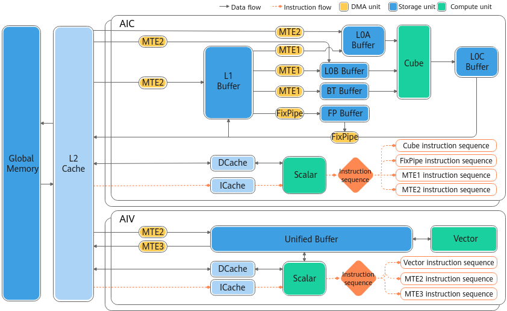
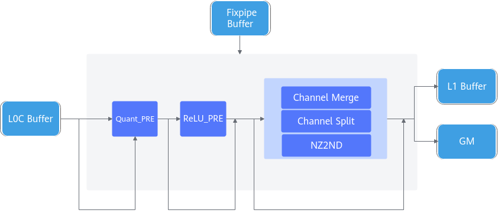
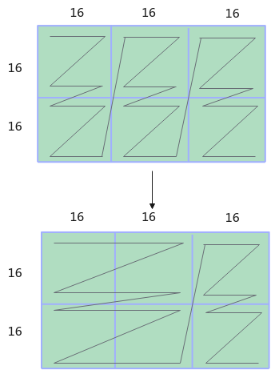
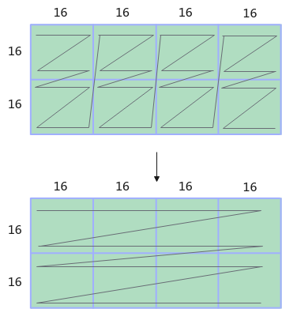
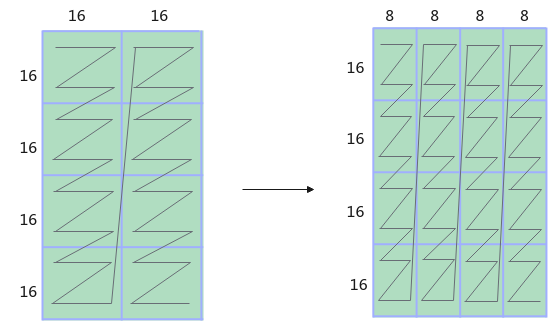
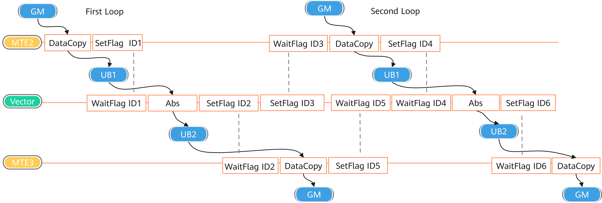
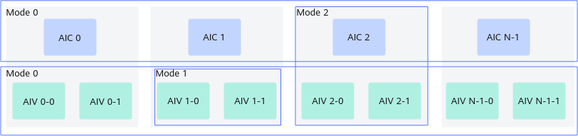
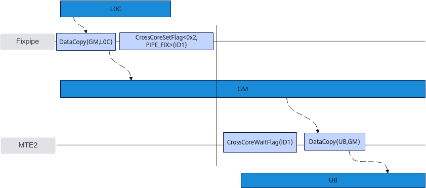

> **Official CANN 9.0.X source reading copy.** [English/Chinese counterpart](../zh/architecture_220x.md); [official page](https://www.hiascend.com/document/detail/en/CANNCommunityEdition/900/programug/Ascendcopdevg/atlas_ascendc_10_0011.html); [unaltered source body](../raw/161af31fefa71e71.html). HTML formatting and image paths are converted for offline reading; no local technical corrections.

 

# NPU Architecture Version 220x

This section describes the hardware architecture and functions of the **__NPU_ARCH__** version 220x. 220 indicates the IP core ID, and x indicates the configuration version of the same IP core. The corresponding product models are as follows:

- Atlas A3 training product / Atlas A3 inference product

- Atlas A2 training product / Atlas A2 inference product

#### Hardware Architecture

As shown in the following figure, the AI Core in this architecture consists of two independent cores: AIC and AIV, which are used for cube computation and vector computation, respectively. Each core has its own Scalar Unit and can independently load its own code segments. Data is transferred between the AIV and AIC through the global memory.

#### Compute Units

**Separated deployment of the Cube Unit and Vector Unit**

In this architecture, the Cube Unit and Vector Unit are deployed on the AIC and AIV cores, respectively. Each core has its own Scalar Unit and can independently load its own code segments.

**Vector Unit**

- The data of the Vector Unit comes from the Unified Buffer and must be 32-byte aligned.

**Cube Unit**

- The Cube Unit can access the L0A Buffer, L0B Buffer, and L0C Buffer. The L0A Buffer stores the left cube, the L0B Buffer stores the right cube, and the L0C Buffer stores the cube multiplication result and intermediate result.

#### Storage Units

**Obtaining the memory size of a storage unit**

You can query the memory size of each storage unit by calling the [platform information acquisition](https://www.hiascend.com/document/detail/en/CANNCommunityEdition/900/API/ascendcopapi/atlasascendc_api_07_1025.html) API.

**Minimum access granularities (alignment requirements) of each storage unit**

<table>
      <thead>
       <tr>
        <th>
         
Core
</th>
        <th>
         
Storage Unit
</th>
        <th>
         
Alignment Requirement
</th>
       </tr>
      </thead>
      <tbody>
       <tr>
        <td>
         
AIV
</td>
        <td>
         
Unified Buffer
</td>
        <td>
         
32-byte aligned.
</td>
       </tr>
       <tr>
        <td rowspan="6">
         
AIC
</td>
        <td>
         
L1 Buffer
</td>
        <td>
         
32-byte aligned.
</td>
       </tr>
       <tr>
        <td>
         
L0A Buffer
</td>
        <td>
         
512-byte aligned.
</td>
       </tr>
       <tr>
        <td>
         
L0B Buffer
</td>
        <td>
         
512-byte aligned.
</td>
       </tr>
       <tr>
        <td>
         
L0C Buffer
</td>
        <td>
         
64-byte aligned.
</td>
       </tr>
       <tr>
        <td>
         
BiasTable Buffer
</td>
        <td>
         
64-byte aligned.
</td>
       </tr>
       <tr>
        <td>
         
Fixpipe Buffer
</td>
        <td>
         
64-byte aligned.
</td>
       </tr>
      </tbody>
     </table>

**Recommended data layout formats for each storage unit**

- The following fractal formats are recommended for the L0A Buffer, L0B Buffer, and L0C Buffer: 

- L0A Buffer: FRACTAL_ZZ

- L0B Buffer: FRACTAL_ZN

- L0C Buffer: FRACTAL_NZ

These formats are optimized for compute-intensive tasks such as cube multiplication, significantly improving the compute efficiency.

- The **FRACTAL_NZ** format is recommended for the L1 Buffer. When the L1 Buffer uses the NZ format, the format conversion overhead is reduced when data is moved to the L0A/L0B Buffer (which needs to be converted to the ZZ and ZN formats, respectively).

- The Unified Buffer has no requirements for the data format.

**Resolving access conflicts of storage units to improve read/write performance**

When multiple operations attempt to access the same bank or bank group of the Unified Buffer at the same time, bank conflicts may occur, including the read-write conflict, write-write conflict, and read-read conflict. As a result, the accesses queue and the performance deteriorates. The read/write performance can be improved by optimizing bank allocation. For details, see [Avoiding Bank Conflicts in the Unified Buffer](https://www.hiascend.com/doc_center/source/en/CANNCommunityEdition/900/programug/Ascendcopdevg/atlas_ascendc_best_practices_10_0025.html).

#### DMA Units

**Alignment requirements during movement**

The size of the data to be moved is subject to certain requirements because the moved data is used for computation. The size of the data moved to the Unified Buffer must be aligned based on the data block size. The data moved to other storage units must be aligned based on the [fractal requirements](https://www.hiascend.com/doc_center/source/en/CANNCommunityEdition/900/programug/Ascendcopdevg/atlas_ascendc_10_0099.html). For example, when data is moved from the L1 Buffer to the L0A Buffer, the data format needs to be converted from NZ to ZZ. The size of the data to be moved must be aligned based on the fractal size. If the remaining size of the L1 Buffer is less than one fractal, an exception will occur during hardware execution.

**Inter-device data movement (HCCS physical link)**

In the development of inter-device communication operators, the DataCopy APIs support inter-device data movement. On the  Atlas A2 training product / Atlas A2 inference product , only HCCS physical links are supported. During development, pay attention to the physical links involved in inter-device communication. You can run the **npu-smi info -t topo** command to query the HCCS physical links.

**FixPipe hardware acceleration**

FixPipe is an acceleration module that hardens typical operations on the NPU. It is located inside the AIC and works with the Cube Unit to complete on-the-fly computation. Its main functions are as follows:

- Quantization and dequantization, including S322FP16, S322S32, S322S4, S322S8, S322S16, FP322FP16, FP322BF16, FP322S8, FP322S4, and FP322FP32.

- ReLU functions, including typical activation functions such as ReLU, PReLU, and Leaky ReLU.

- Data format conversion, including: 

- Fractal size conversion through Channel Merge and Channel Split, ensuring that the fractal output to the L1 Buffer/GM meets the requirements.

- NZ2ND data format conversion.

In the preceding figure, Channel Merge supports the S8, U8, S4, and U4 data types, while Channel Split supports the FP32 data type.

- Channel Merge (S8 and U8 data types) 

For the target data type converted to S8 or U8, the fractal cube is converted from 16×16 to 16×32 through hardware. If the number of output channels (N) is an even multiple of 16, every two adjacent 16×16 fractal cubes in the N direction are merged into one 16×32 fractal cube. If the value of N is an odd multiple of 16, channels [1, N–16] are merged; the final 16 channels are not merged.

As shown below, the target data type is S8, M is 32, and N is 48. First, the 16×16 fractal cubes in the first two columns are merged into one 16×32 cube, and then the remaining 16×16 fractal cubes are directly moved to the L1 Buffer.

- Channel Merge (S4 and U4 data types) 

For the target data type converted to S4 or U4, the fractal cube is converted from 16×16 to 16×32 through hardware. If the number of output channels (N) is a multiple of 64, every four adjacent 16×16 fractal cubes in the N direction are merged into a single 16×64 fractal cube.

For example, the target data type is S4, M is 32, and N is 64. First, the 16×16 fractal cubes in the first row are merged into a 16×64 cube, and then the 16×16 fractal cubes in the second row are also merged.

In this case, N must be a multiple of 64.

- FP32 Channel Split: 

For the target type FP32, the fractal cube can be converted from 16×16 to 16×8 through hardware. If Channel Split is enabled, each 16×16 fractal cube is split into two 16×8 fractal cubes.

As shown in the following figure, the target data type is FP32, M is 64, and N is 32. The cube is split into sixteen 16×8 fractals.

#### Synchronization Control

- Intra-core synchronization 

The execution units (such as the MTE2 and Vector Unit) within the AI Core operate asynchronously and in parallel. As a result, data dependencies may arise when reading data from or writing data to the local memory (such as the Unified Buffer). To ensure data consistency and computational accuracy, synchronization control is required to coordinate the timing of operations.

For example, in the process where the MTE2 moves data from the GM to the UB for Abs computation by the Vector Unit and then moves the data back to the GM, the following synchronization conditions must be met:

- Data movement and computation sequence 

- Start Abs computation by the Vector Unit after data is moved from the GM to the UB (to avoid data loss caused by incomplete movement during computation).

- After the vector computation is complete, move data from the UB to the GM (to ensure that the result data is ready).

- Synchronization rules for cyclic data movement and computation scenarios 

- Start new data movement after the previous computation is complete. Do not trigger new data movement when the previous computation is not complete (to prevent the old data in the UB from being overwritten).

- Start new computation after the previous data is moved out. Do not trigger a new computation task when the previous data is not completely moved out from the UB (to avoid overwriting conflicts in the target memory area).

The synchronization control process is shown in the following figure.

In the preceding figure, ID1, ID2, ID3, ID4, ID5, and ID6 represent event IDs. Each event ID corresponds to the movement status of a piece of stored data, ensuring the correctness and consistency of data operations.

 Note the following: 

- You are advised to obtain the event ID through the [AllocEventID](https://www.hiascend.com/document/detail/en/CANNCommunityEdition/900/API/ascendcopapi/atlasascendc_api_07_0114.html) or [FetchEventID](https://www.hiascend.com/document/detail/en/CANNCommunityEdition/900/API/ascendcopapi/atlasascendc_api_07_0116.html) API to ensure its validity.

- The number of event IDs is limited. After using an event ID, call **ReleaseEventID** immediately to release the event ID, preventing event ID exhaustion and ensuring normal system operating.

- **SetFlag** and **WaitFlag** must be used in pairs, and their parameters must be completely the same (including the template parameters and event ID). If they do not match, the computation of the current core may be abnormal, or the execution of the operator on the next core may be affected, causing a timeout. 

For example, **SetFlag<HardEvent::S_MTE3>(1)** and **SetFlag<HardEvent::MTE3_MTE1>(1)** set different event IDs because their template parameters are different. They set the same event ID only when their template parameters and event IDs are the same.

- Do not set the same event ID consecutively. Otherwise, the event status may be disordered or not correctly processed.

- You are advised not to manually insert TEventIDs. Do not manually insert TEventIDs 6 and 7 because they may be reserved by the system or used for special purposes.

- Inter-core synchronization 

When different cores operate the same global memory, data dependency issues such as read-after-write, write-after-read, and write-after-write may occur. To avoid such issues, inter-core synchronization control is required.

The inter-core synchronization control has the following modes, as shown in the following figure.

- Mode 0: synchronization control between AI Cores. In the AIC scenario, all AIC cores are synchronized. The subsequent instructions of **CrossCoreWaitFlag** are executed only when all AIC cores execute **CrossCoreSetFlag**. In the AIV scenario, all AIV cores are synchronized. The subsequent instructions of **CrossCoreWaitFlag** are executed only when all AIV cores execute **CrossCoreSetFlag**.

- Mode 1: synchronization control between AIV cores in the AI Core. The subsequent instructions of **CrossCoreWaitFlag** are executed only when both AIV cores run **CrossCoreSetFlag**.

- Mode 2: synchronization control between AIC and AIV cores in the AI Core. The subsequent instructions of **CrossCoreWaitFlag** on the two AIV cores are executed only after **CrossCoreSetFlag** is executed on the AIC core, and vice versa.

For example, after the AIC core moves the L0C computation result to the GM, the AIV core needs to move the GM data to the UB. In this case, you can use the **CrossCoreSetFlag** and **CrossCoreWaitFlag** commands to ensure that the data is successfully moved from the L0C to the GM and then from the GM to the UB. The following figure shows the process.

The [CrossCoreSetFlag](https://www.hiascend.com/document/detail/en/CANNCommunityEdition/900/API/ascendcopapi/atlasascendc_api_07_0273.html) and [CrossCoreWaitFlag](https://www.hiascend.com/document/detail/en/CANNCommunityEdition/900/API/ascendcopapi/atlasascendc_api_07_0274.html) APIs are used together. The flag ID (**flagId**, that is, ID1 in the above figure) for inter-core synchronization needs to be passed in. Each ID corresponds to a counter whose initial value is **0**. After **CrossCoreSetFlag** is executed, the value of the counter corresponding to the ID is incremented by 1. If the counter value is **0**, **CrossCoreWaitFlag** is not executed. If the counter value is greater than 0, the counter decreases by 1 and subsequent instructions start to be executed. The value of **flagId** ranges from 0 to 10.

Note the following:

- **Used in pairs** 

**CrossCoreSetFlag** and **CrossCoreWaitFlag** must be used in pairs. Otherwise, the operator may time out.

- **Data consistency** 

The template parameters and **flagId** of **CrossCoreSetFlag** must be the same as those of **CrossCoreWaitFlag**. Otherwise, they are considered as different flag IDs. For example, **CrossCoreSetFlag<0x0, PIPE_MTE3>(0x8)** and **CrossCoreSetFlag<0x2, PIPE_FIX>(0x8)** set different flag IDs.

- **Avoiding consecutive settings** 

Setting the same flag ID consecutively is not allowed, preventing the counter status from being disordered.

- **Use conflict with high-level APIs** 

This API is used to control inter-core synchronization in the internal implementation of the Matmul high-level APIs. Therefore, you are advised not to use this API and the Matmul high-level APIs at the same time. Otherwise, flag IDs may conflict.

- **Counter restrictions** 

The counter of the same flag ID can be set for a maximum of 15 times.

- **Default pipeline type** 

The instruction pipeline type does not need to be explicitly set for **CrossCoreWaitFlag**. **PIPE_S** is used by default.

 **Parent topic:** [Architecture Specifications](https://www.hiascend.com/doc_center/source/en/CANNCommunityEdition/900/programug/Ascendcopdevg/atlas_ascendc_10_0009.html)
