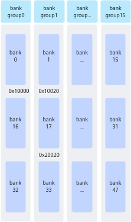

> **Official CANN 9.0.X source reading copy.** [English/Chinese counterpart](../zh/bank_conflicts_220x.md); [official page](https://www.hiascend.com/document/detail/en/CANNCommunityEdition/900/programug/Ascendcopdevg/atlas_ascendc_best_practices_10_00020.html); [unaltered source body](../raw/95197eda21dbafe1.html). HTML formatting and image paths are converted for offline reading; no local technical corrections.

 

# Avoiding Bank Conflicts (NPU Architecture Version 220x)

[Priority] High

This performance optimization suggestion applies to the following product models:

- Atlas A3 training product / Atlas A3 inference product

- Atlas A2 training product / Atlas A2 inference product

[Description] To improve data access efficiency and throughput, the Unified Buffer adopts a bank (memory modules of the same size) structure. The Unified Buffer has a total size of 192 KB and is divided into 48 banks. Each bank consists of 128 rows, with each row being 32 bytes long. These 48 banks are further organized into 16 bank groups, with each bank group containing three banks. For example, bank15, bank31, and bank47 form a bank group.

 **Figure 1 **Bank structure (the arrow direction indicates the memory layout sequence) 

Each bank can independently read and write data, and multiple data requests can be processed at the same time. However, when a plurality of read/write operations attempt to access a same bank or bank group at the same time, due to a limitation of hardware resources, these operations need to wait in a queue, resulting in a bank conflict and performance deterioration.

Specifically, the Vector Unit can read or write a row of data from or into each bank group in each cycle (an instruction cycle). If multiple operations in the same API attempt to access the same bank or bank group at the same time, the Vector Unit cannot process all requests in the same cycle. As a result, these requests wait in a queue. This queuing increases the data access latency and reduces the overall system performance.

#### Typical Scenarios of Bank Conflicts

Bank conflicts can be classified into the following three scenarios:

- **Read/Write conflict**: A read operation and a write operation attempt to access the same bank at the same time.

- **Write/Write conflict**: Multiple write operations attempt to access the same bank group at the same time.

- **Read/Read conflict**: Multiple read operations attempt to access the same bank group at the same time.

The following provides some specific examples. Assume that 0x10000 is on bank16, 0x10020 is on bank17, and 0x20020 is on bank33, as shown in the following figure.

 **Figure 2 **Address allocation 

- Example of a read/write conflict 

 When the source operand src and destination operand dst of the Vector instruction are read and written to the same bank at the same time, a read/write conflict occurs. The details are as follows: 

<table>

          <b>Table 1 </b>Example of a read/write conflict

         <thead>
          <tr>
           <th>
            
No.
</th>
           <th>
            
src addr
</th>
           <th>
            
dst addr
</th>
           <th>
            
bank
</th>
           <th>
            
bank group
</th>
           <th>
            
Conclusion
</th>
          </tr>
         </thead>
         <tbody>
          <tr>
           <td>
            
Example 1
</td>
           <td>
            
0x10020
</td>
           <td>
            
0x10000
</td>
           <td>
            
bank_id0 != bank_id1
</td>
           <td>
            
bank_group_id0 != bank_group_id1
</td>
           <td>
            
The addresses of src and dst are in bank16 and bank17, respectively. Therefore, no conflict occurs.
</td>
          </tr>
          <tr>
           <td>
            
Example 2
</td>
           <td>
            
0x10020
</td>
           <td>
            
0x10E20
</td>
           <td>
            
bank_id0 == bank_id1
</td>
           <td>
            
bank_group_id0 == bank_group_id1
</td>
           <td>
            
The addresses of src and dst are both in bank17. Therefore, a conflict occurs.
</td>
          </tr>
         </tbody>
        </table>

- Example of a write/write conflict 

 When eight data blocks (block0 to block7) corresponding to the destination operand dst of the Vector instruction are written to the same bank group, a write/write conflict occurs. The details are as follows: 

<table>

          <b>Table 2 </b>Example of a write/write conflict

         <thead>
          <tr>
           <th>
            
No.
</th>
           <th>
            
dst addr
</th>
           <th>
            
blk_stride
</th>
           <th>
            
block0_addr
</th>
           <th>
            
block1_addr
</th>
           <th>
            
block2_addr
</th>
           <th>
            
...
</th>
           <th>
            
Conclusion
</th>
          </tr>
         </thead>
         <tbody>
          <tr>
           <td>
            
Example 1
</td>
           <td>
            
0x1FE00
</td>
           <td>
            
16
</td>
           <td>
            
0x1FE00
</td>
           <td>
            
0x20000
</td>
           <td>
            
0x20200
</td>
           <td>
            
...
</td>
           <td>
            
All eight data blocks are in the same bank group. Therefore, conflicts occur. One repeat is written in eight cycles.
</td>
          </tr>
          <tr>
           <td>
            
Example 2
</td>
           <td>
            
0x1FE00
</td>
           <td>
            
8
</td>
           <td>
            
0x1FE00
</td>
           <td>
            
0x1FF00
</td>
           <td>
            
0x20000
</td>
           <td>
            
...
</td>
           <td>
            
block0 and block2 are in the same bank group and conflict with each other. One repeat is written in four cycles.
</td>
          </tr>
         </tbody>
        </table>

- Read/Read conflict 

- When multiple source operands of the Vector instruction are read to the same bank group at the same time, a read/read conflict occurs. The analysis is as follows: 

<table>

           <b>Table 3 </b>Example of a read/read conflict with two source addresses

          <thead>
           <tr>
            <th>
             
No.
</th>
            <th>
             
src0 addr
</th>
            <th>
             
src1 addr
</th>
            <th>
             
bank
</th>
            <th>
             
bank group
</th>
            <th>
             
Conclusion
</th>
           </tr>
          </thead>
          <tbody>
           <tr>
            <td>
             
Example 1
</td>
            <td>
             
0x10020
</td>
            <td>
             
0x20020
</td>
            <td>
             
bank_id0 != bank_id1
</td>
            <td>
             
bank_group_id0 == bank_group_id1
</td>
            <td>
             
Conflict
</td>
           </tr>
           <tr>
            <td>
             
Example 2
</td>
            <td>
             
0x10020
</td>
            <td>
             
0x10000
</td>
            <td>
             
bank_id0 != bank_id1
</td>
            <td>
             
bank_group_id0 != bank_group_id1
</td>
            <td>
             
No conflict
</td>
           </tr>
          </tbody>
         </table>

- When the eight data blocks (block0 to block7) corresponding to a source operand of the Vector instruction are read to the same bank group, a read/read conflict occurs. The analysis is as follows: 

<table>

           <b>Table 4 </b>Example of a read/read conflict with a single source address

          <thead>
           <tr>
            <th>
             
No.
</th>
            <th>
             
src addr
</th>
            <th>
             
blk_stride
</th>
            <th>
             
block0_addr
</th>
            <th>
             
block1_addr
</th>
            <th>
             
block2_addr
</th>
            <th>
             
...
</th>
            <th>
             
Conclusion
</th>
           </tr>
          </thead>
          <tbody>
           <tr>
            <td>
             
Example 1
</td>
            <td>
             
0x1FE00
</td>
            <td>
             
16
</td>
            <td>
             
0x1FE00
</td>
            <td>
             
0x20000
</td>
            <td>
             
0x20200
</td>
            <td>
             
...
</td>
            <td>
             
All eight data blocks are in the same bank group. Therefore, conflicts occur. One repeat is read in eight cycles.
</td>
           </tr>
           <tr>
            <td>
             
Example 2
</td>
            <td>
             
0x1FE00
</td>
            <td>
             
8
</td>
            <td>
             
0x1FE00
</td>
            <td>
             
0x1FF00
</td>
            <td>
             
0x20000
</td>
            <td>
             
...
</td>
            <td>
             
block0 and block2 are in the same bank group. Therefore, a conflict occurs. One repeat is completed in four cycles.
</td>
           </tr>
          </tbody>
         </table>

The msProf tool can be used to collect profile data related to the resource conflict ratio.

For details about how to use the tool and the description of the profile data file, see [Operator Development Tools](https://www.hiascend.com/document/detail/en/CANNCommunityEdition/900/devaids/optool/docs/en/quick_start/mskpp_quick_start.md).

#### How to Avoid Bank Conflicts

There are two methods to avoid bank conflicts: **optimizing the computation logic** and **optimizing address allocation**.

- **Optimizing the computation logic** 

Perform the (1, 0, 2) transpose operation on an input with shape (8, 16, 16). Then, the output shape is (16, 8, 16). You can avoid conflicts by changing the computation logic from "skipped read and continuous write" to "continuous read and skipped write". The implementation solutions are compared as follows:

<table>
        <thead>
         <tr>
          <th>
           
Implementation
</th>
          <th>
           
Original Implementation
</th>
          <th>
           
Optimized Implementation
</th>
         </tr>
        </thead>
        <tbody>
         <tr>
          <td>
           
Implementation method
</td>
          <td>
           
Read skipping, continuous write

           
The eight data blocks input in the same repeat are in the same bank group, causing a read/read conflict.
</td>
          <td>
           
Continuous read, skip write

           
The eight data blocks input in the same repeat are not in the same bank group, avoiding a read/read conflict.
</td>
         </tr>
         <tr>
          <td>
           
Diagram
</td>
          <td>
           

</td>
          <td>
           

</td>
         </tr>
         <tr>
          <td>
           
Sample code
</td>
          <td>

             <table>
              <tbody>
               <tr>
                <td>

                  <pre>1
2
3
4
5
6
7</pre>
                 </td>
                <td>

                  <pre>uint64_t mask = 128;
UnaryRepeatParams params;
params.dstBlkStride  = 1;
params.srcBlkStride = 16;
for(uint32_t i=0; i&lt;16; i++)   {
    AscendC::Adds(dstLocal[i * 128], srcLocal[i * 16], 0, mask, 1, params);
}
</pre>
                 </td>
               </tr>
              </tbody>
             </table>

           </td>
          <td>

             <table>
              <tbody>
               <tr>
                <td>

                  <pre>1
2
3
4
5
6
7</pre>
                 </td>
                <td>

                  <pre>uint64_t mask = 128;
UnaryRepeatParams params;
params.dstBlkStride  = 8;
params.srcBlkStride = 1;
for(uint32_t i=0; i&lt;8; i++)   {
    AscendC::Adds(dstLocal[i * 16], srcLocal[i * 256], 0, mask, 2, params);
}
</pre>
                 </td>
               </tr>
              </tbody>
             </table>

           </td>
         </tr>
        </tbody>
       </table>

- **Optimizing address allocation** 

Implement the addition of 4096 consecutive float elements (z = x + y). By allocating more memory, ensure that x and y do not appear in the same bank group at the same time, and x/y and z do not appear in the same bank at the same time within a repeat. For details about the complete example, see [sample of avoiding bank conflicts](https://gitee.com/ascend/samples/tree/master/operator/ascendc/4_best_practices/4_bank_conflict).

The implementation solutions are compared as follows:

<table>
        <thead>
         <tr>
          <th>
           
Implementation
</th>
          <th>
           
Original Implementation
</th>
          <th>
           
Optimized Implementation
</th>
         </tr>
        </thead>
        <tbody>
         <tr>
          <td>
           
Implementation method
</td>
          <td>
           
No address optimization is performed. InitBuffer is directly used to allocate memory. The addresses of each tensor are as follows:

           
x: The start address is 0x0, and the tensor length is 4096 x sizeof(float) bytes.

           
y: The start address is 0x4000, and the tensor length is 4096 x sizeof(float) bytes.

           
z: The start address is 0x8000, and the tensor length is 4096 x sizeof(float) bytes.

           
In a repeat, x and y read the same bank group at the same time, and x/y and z read and write the same bank at the same time.
</td>
          <td>
           
Optimize the address. When InitBuffer is used to allocate memory, properly allocate more memory. The addresses of each tensor are as follows:

           
x: The start address is 0x0, and the tensor length is (4096 x sizeof(float) + 256) bytes.

           
y: The start address is 0x4100, and the tensor length is (64 x 1024 – (4096 x sizeof(float) + 256)) bytes.

           
z: The start address is 0x10000, and the tensor length is 4096 x sizeof(float) bytes.

           
Allocate 256 bytes more for x to prevent x and y from reading the same bank group in a repeat. Allocate more space for y to ensure that z does not fall into the same bank as x or y.
</td>
         </tr>
         <tr>
          <td>
           
Diagram
</td>
          <td>
           

</td>
          <td>
           

</td>
         </tr>
         <tr>
          <td>
           
Sample code
</td>
          <td>

             <table>
              <tbody>
               <tr>
                <td>

                  <pre>1
2
3</pre>
                 </td>
                <td>

                  <pre>pipe.InitBuffer(inQueueX, 1, 4096 * sizeof(float));
pipe.InitBuffer(inQueueY, 1, 4096 * sizeof(float));
pipe.InitBuffer(outQueueZ, 1, 4096 * sizeof(float));
</pre>
                 </td>
               </tr>
              </tbody>
             </table>

           </td>
          <td>

             <table>
              <tbody>
               <tr>
                <td>

                  <pre>1
2
3</pre>
                 </td>
                <td>

                  <pre>pipe.InitBuffer(inQueueX, 1, 4096 * sizeof(float) + 256); // Allocate 256 bytes more.
pipe.InitBuffer(inQueueY, 1, 64 * 1024 - (4096 * sizeof(float) + 256)); // Allocate more space to ensure that z does not fall into the same bank as x/y. 64 * 1024 is the space of 16 banks, and 4096 * sizeof(float) + 256 is the space occupied by x.
pipe.InitBuffer(outQueueZ, 1, 4096 * sizeof(float));
</pre>
                 </td>
               </tr>
              </tbody>
             </table>

           </td>
         </tr>
        </tbody>
       </table>

 **Parent topic:** [Avoiding Bank Conflicts in the Unified Buffer](https://www.hiascend.com/doc_center/source/en/CANNCommunityEdition/900/programug/Ascendcopdevg/atlas_ascendc_best_practices_10_0025.html)
