> **Official CANN 9.0.X source reading copy.** [English/Chinese counterpart](../zh/basic_architecture.md); [official page](https://www.hiascend.com/document/detail/en/CANNCommunityEdition/900/programug/Ascendcopdevg/atlas_ascendc_10_0008.html); [unaltered source body](../raw/68fe64e90ce6e9be.html). HTML formatting and image paths are converted for offline reading; no local technical corrections.

 

# Basic Architecture

As shown in the following figure, operators developed using Ascend C run on the AI Core. The Ascend C programming model is introduced based on the abstraction of the AI Core hardware architecture. Understanding the hardware architecture helps you better understand the programming model. For experienced developers who need to complete high-performance programming, it is even more important to learn about the hardware architecture. Many contents in the operator practice reference are introduced based on this chapter.

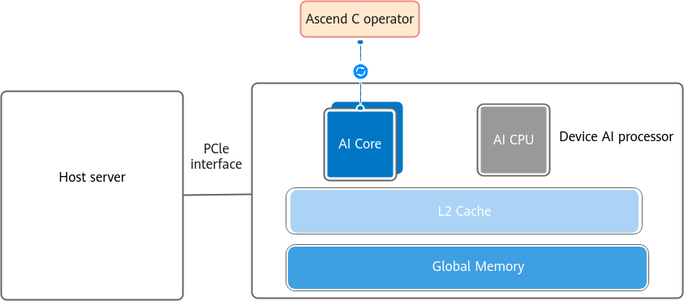

The AI Core is responsible for executing cube and vector computation–intensive tasks. It consists of the following components:

- **Compute units**: include the Cube Unit, Vector Unit, and Scalar Unit.

- **Storage units**: include the L1 Buffer, L0A Buffer, L0B Buffer, L0C Buffer, Unified Buffer, BiasTable Buffer, and FixPipe Buffer, which are designed for efficient computation.

- **Movement units**: include the MTE1, MTE2, MTE3, and FixPipe, which are used for efficient data transmission between different storage units.

Take  Atlas A2 training product / Atlas A2 inference product  as an example. The following figure shows its hardware architecture.

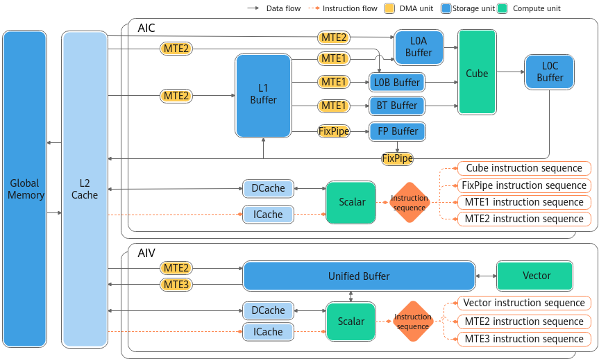

This section first introduces the key concepts and terms related to the hardware architecture and the working mode of the AI Core, laying a foundation for understanding the subsequent content. Then, using  Atlas A2 training product / Atlas A2 inference product  as an example, this section provides an introduction to the basic architecture of the AI Core. It first describes the basic functions and structures of the compute units, storage units, and movement units, and then uses typical data flow and control flow examples to help you gain a deeper understanding of the working principles of the hardware architecture. For details about the specific architecture specifications of different product models, see [Architecture Specifications](https://www.hiascend.com/doc_center/source/en/CANNCommunityEdition/900/programug/Ascendcopdevg/atlas_ascendc_10_0009.html).

#### Key Concepts and Terms

- Core 

Compute core with an independent Scalar Unit. The Scalar Unit is a scheduling unit within a core and is responsible for functions such as instruction transmission within the core.

- AI Core 

A compute core of an AI processor, which executes tasks with intensive cube and vector compute.

- Cube Core 

A core dedicated for cube computation. It consists of the Scalar Unit, Cube Unit, and DMA Unit, but does not include the Vector Unit.

- Vector Core 

A core dedicated for vector computation. It consists of the Scalar Unit, Vector Unit, and DMA Unit, but does not include the Cube Unit.

- AIC 

A Cube Core in a group of Cube Cores and Vector Cores in [separated mode](https://www.hiascend.com/doc_center/source/en/CANNCommunityEdition/900/programug/Ascendcopdevg/atlas_ascendc_10_0008.html#EN-US_TOPIC_0000002531522198__li188191010204418) of AI Core.

- AIV 

A Vector Core in a group of Cube Cores and Vector Cores in [separated mode](https://www.hiascend.com/doc_center/source/en/CANNCommunityEdition/900/programug/Ascendcopdevg/atlas_ascendc_10_0008.html#EN-US_TOPIC_0000002531522198__li188191010204418) of AI Core.

  

#### AI Core Working Modes

- Separated mode 

A working mode of AI Core. The Cube Unit and Vector Unit each have their own Scalar Unit, and they are deployed on the Cube Core and Vector Core, respectively. By combining Cube Cores and Vector Cores in a certain ratio (1:N), such a combination is considered as an AI Core. The number of AI Cores is determined by the number of Cube Cores.

 **Figure 1 **Separated mode diagram (N is subject to the value obtained by the hardware platform information acquisition API.) 

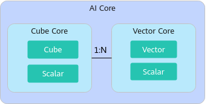

- Coupled mode 

A working mode of AI Core. The Cube Unit and Vector Unit share the same Scalar Unit, which is deployed on an AI Core.

 **Figure 2 **Coupled mode diagram 

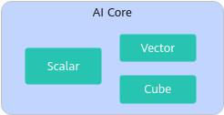

 In Ascend C programming, the working modes of different products are as follows: 

- Atlas inference product : coupled mode

- Atlas training product : coupled mode

- Atlas A2 training product / Atlas A2 inference product : separated mode

- Atlas A3 training product / Atlas A3 inference product : separated mode

- Atlas 350 Accelerator Card: separated mode

- Atlas 200I/500 A2 inference product : coupled mode

Note: For the  Atlas 200I/500 A2 inference product , the hardware working mode can be either coupled mode or separated mode. In coupled mode, you only need to concern about the number of AI Cores, and do not need to concern about the number of Vector Cores and Cube Cores. In separated mode, you need to concern about the number of AI Cores, Vector Cores, and Cube Cores. In Ascend C programming scenarios, only the coupled mode is supported.

#### Compute Units

The compute units are the core of powerful compute capabilities of the AI Core, including the Cube Unit, Vector Unit, and Scalar Unit. These three units process different types of data in the AI Core.

- Cube 

The Cube Unit performs cube operations. Take the float16 data type as an example. The Cube Unit can multiply two 16×16 cubes of the float16 data type in each execution. As shown in the following figure, the highlighted boxes show the Cube Unit and its accessed storage units. L0A stores the left cube, L0B stores the right cube, and L0C stores the cube multiplication result and intermediate result.

 **Figure 3 **Data access of the Cube Unit 

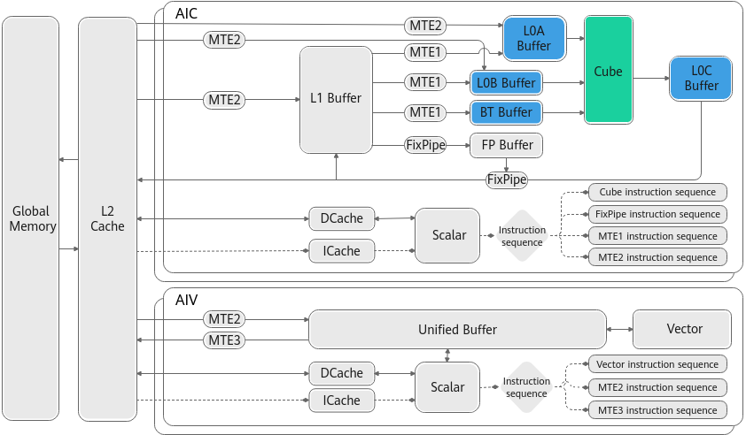

- Vector 

The Vector Unit performs vector computation. It executes vector instructions, which are similar to conventional single instruction multiple data (SIMD) instructions. Each vector instruction can complete the same type of operation for a plurality of operands. The Vector Unit can quickly add or multiply two float16 vectors. Vector instructions support multiple repeats and direct computation of vectors with intervals.

As shown in the following figure, all the computed source data and target data of the vector must be stored in the Unified Buffer. The start address and operation length of vector instructions must be 32-byte aligned. For details, see the API constraints.

 **Figure 4 **Data access of the Vector Unit 

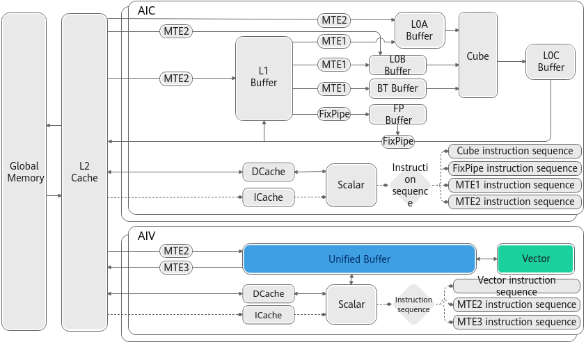

- Scalar 

The Scalar Unit performs scalar computation and controls the program flow. It can be regarded as a mini CPU, which implements loop control, branch judgment, address and parameter computations of Cube and Vector instructions, and basic arithmetic operations for a program. In addition, the pipeline of other execution units in the AI Core can be controlled by inserting a synchronization code into the event synchronization module. Compared with the host CPU, the scalar computation capability on the AI Core is relatively weak, and scalars are mainly used to send instructions. Therefore, scalar computations should be minimized in actual application scenarios, for example, minimizing the branch judgment such as the **if/else** statement and variable computation during performance optimization.

As shown in the following figure, the Scalar Unit executes standard arithmetic logic unit (ALU) statements when executing scalar operation instructions. The code segment and data segment (stack space) required by ALU come from the GM. The instruction cache (iCache) is used to cache code segments, and the cache size is related to hardware specifications. If the size is 16 KB or 32 KB, the code segment is loaded in the unit of 2 KB. The data cache (dCache) is used to cache data segments, and the cache size is related to hardware specifications. If the size is 16 KB, the data segment is loaded in the unit of cache lines (64 bytes). Considering that access inside the core is most efficient, ensure that code segments and data segments are cached in the iCache and dCache to avoid access outside the core. In addition, based on the data loading unit, you can adjust the size of data to be loaded at a time during programming to improve the loading efficiency. For example, when data is loaded to the dCache and the start address of the data memory is aligned with the cache lines (64 bytes), the loading efficiency is the highest.

 **Figure 5 **Instruction and data access of the Scalar Unit 

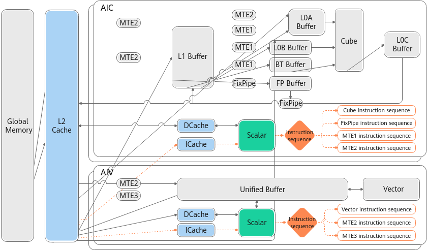

The hardware provides the L2 cache to cache the data (including code segments and data segments) that accesses the GM, thereby accelerating the access speed and improving the access efficiency. The L2 cache outside the core loads data in the unit of cache lines. The cache line size (128, 256, or 512 bytes) varies with hardware specifications.

  

#### Storage Units and DMA Units

To fully leverage the powerful computing capability of the AI processors, the prerequisite is that the input data can be fed to the compute units in a timely and accurate manner. Therefore, the memory system needs to be elaborately designed to ensure the data supply required by the compute units.

As shown in the following figure, an AI Core includes multiple levels of local memory (internal storage), and loads data from the global memory (external storage) to the local memory for computation. The local memory of an AI Core includes the L1 Buffer, L0 Buffer, Unified Buffer, and so on. An AI Core also contains memory transfer engines (MTEs) to facilitate data movement and copy, which can convert the data format or type during data movement.

For details about the internal storage units and DMA units, see [Table 1](https://www.hiascend.com/doc_center/source/en/CANNCommunityEdition/900/programug/Ascendcopdevg/atlas_ascendc_10_0008.html#EN-US_TOPIC_0000002531522198__table1692510612218) and [Table 2](https://www.hiascend.com/doc_center/source/en/CANNCommunityEdition/900/programug/Ascendcopdevg/atlas_ascendc_10_0008.html#EN-US_TOPIC_0000002531522198__table288493152012).

 **Figure 6 **Storage units 

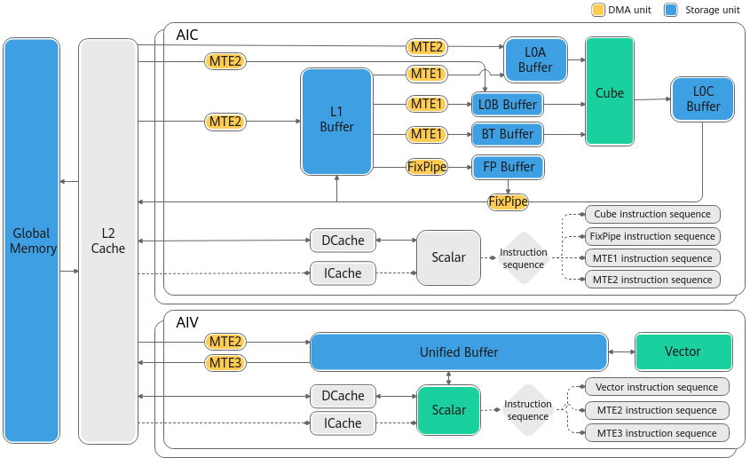

  

<table>

       <b>Table 1 </b>Description of storage units

      <thead>
       <tr>
        <th>
         
Storage Unit
</th>
        <th>
         
Description
</th>
       </tr>
      </thead>
      <tbody>
       <tr>
        <td>
         
L1 Buffer
</td>
        <td>
         
As a general part of the local memory, the L1 Buffer offers a large data buffer in the AI Core. It can temporarily store data that needs to be repeatedly used in the Cube Unit, thereby reducing the frequency that data is read from or written to the bus.
</td>
       </tr>
       <tr>
        <td>
         
L0A Buffer/L0B Buffer
</td>
        <td>
         
They store the inputs of Cube instructions.
</td>
       </tr>
       <tr>
        <td>
         
L0C Buffer
</td>
        <td>
         
It stores the outputs of Cube instructions, which are part of the inputs for accumulation.
</td>
       </tr>
       <tr>
        <td>
         
Unified Buffer
</td>
        <td>
         
The Unified Buffer stores the inputs and outputs of vector and scalar computations.
</td>
       </tr>
       <tr>
        <td>
         
BT Buffer
</td>
        <td>
         
The BiasTable (BT) Buffer stores the bias in cube computations.
</td>
       </tr>
       <tr>
        <td>
         
FP Buffer
</td>
        <td>
         
The FixPipe (FP) Buffer stores quantization parameters and ReLU parameters.
</td>
       </tr>
      </tbody>
     </table>

  

<table>

       <b>Table 2 </b>DMA units

      <thead>
       <tr>
        <th>
         
DMA Unit
</th>
        <th>
         
Description
</th>
       </tr>
      </thead>
      <tbody>
       <tr>
        <td>
         
MTE1
</td>
        <td>
         
Moves data in the following paths:

         <ul>
          <li>L1-&gt;L0A/L0B</li>
          <li>L1-&gt;BT Buffer</li>
         </ul></td>
       </tr>
       <tr>
        <td>
         
MTE2
</td>
        <td>
         
Moves data in the following paths:

         <ul>
          <li>GM-&gt;{L1, L0A/B}. In this path, data is moved based on the fractal size. If the data movement meets the cache line size alignment requirements, the performance is better.</li>
          <li>GM-&gt;UB. Data movement based on the cache line size will achieve better performance.</li>
         </ul></td>
       </tr>
       <tr>
        <td>
         
MTE3
</td>
        <td>
         
Moves data in the following paths:

         <ul>
          <li>UB -&gt; GM</li>
         </ul></td>
       </tr>
       <tr>
        <td>
         
FixPipe
</td>
        <td>
         
Moves data in the following paths. (The data format or type can be converted during data movement.)

         <ul>
          <li>L0C-&gt;{GM/L1}</li>
          <li>L1-&gt;FP Buffer</li>
         </ul></td>
       </tr>
      </tbody>
     </table>

- The size of a storage unit varies with the AI processor type. You can call [GetCoreMemSize](https://www.hiascend.com/document/detail/en/CANNCommunityEdition/900/API/ascendcopapi/atlasascendc_api_07_1034.html) to get the size.

- By default, all data that is read from or written to the GM through the DMA units is cached in the L2 cache to accelerate the access speed and improve the access efficiency. The L2 cache outside the core loads data in the unit of cache lines. The cache line size (128, 256, or 512 bytes) varies with hardware specifications.

#### Typical Data Flows

- The following figure shows the typical data flow of vector computation. 

GM → UB → Vector → UB → GM

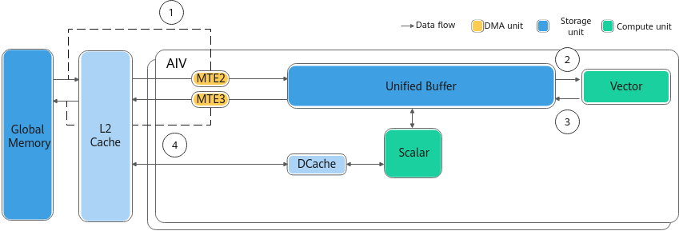

- The following figure shows the typical data flows of cube computation. 

- GM →L1→L0A/L0B →Cube →L0C→FixPipe→GM

- GM →L1→L0A/L0B →Cube →L0C→FixPipe→L1

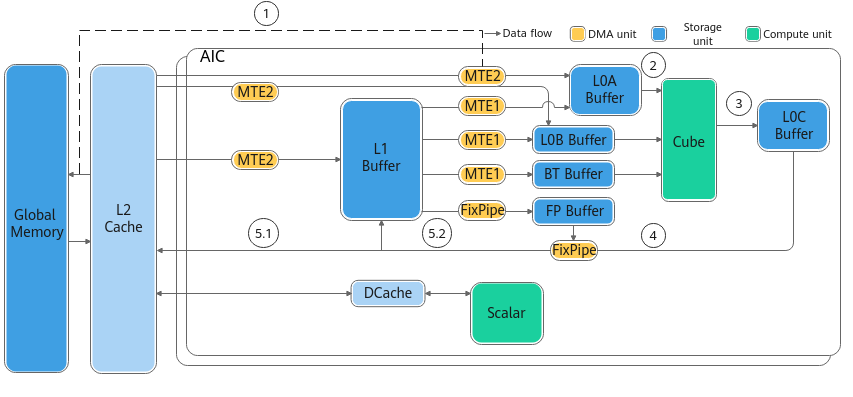

#### Typical Instruction Flows

Multiple instructions enter the iCache from the system memory through the bus. Based on the instruction type, there are two kinds of subsequent instruction execution processes:

- For a scalar instruction, it will be executed immediately by the Scalar Unit.

- For other instructions, they are scheduled to independent queues (vector instruction queue, cube instruction queue, and MTE1/MTE2/MTE3 instruction queues) by the Scalar Unit, and then executed by corresponding execution units.

 **Figure 7 **Instruction processing by category 

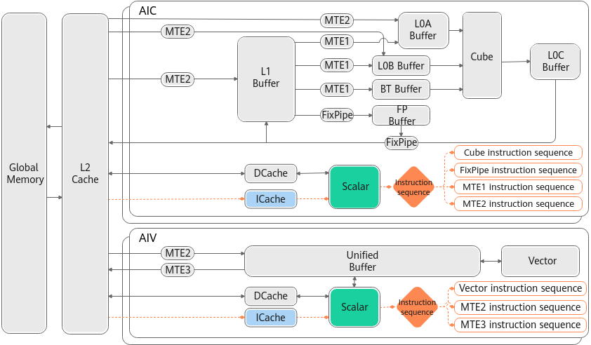

 Instructions in the same queue are executed according to their enqueue sequence, and instructions in different queues can be executed in parallel. Such parallelism improves overall execution efficiency. For data dependency that may occur during parallel execution, the Event Sync module inserts synchronization instructions to control pipeline synchronization. The **PipeBarrier** and **SetFlag**/**WaitFlag** APIs are provided to ensure that the instructions in a queue and across queues are executed based on the logical relationship. 

- **PipeBarrier** is an instruction used to control the execution sequence in a queue. (Although instructions are executed in sequence, it does not mean that the execution of the previous instruction ends when the next instruction starts to be executed.) **PipeBarrier** ensures that all data read and write operations of the previous instruction are completed before the next instruction is executed.

- **SetFlag** and **WaitFlag** are a pair of inter-queue synchronization instructions. 

- **SetFlag**: The current instruction starts to be executed after all read and write operations of the current instruction are completed and the corresponding flag bit in hardware is set to **1**.

- **WaitFlag**: When this instruction is executed, if the corresponding flag bit is **0**, the subsequent instructions in the queue are blocked; if the corresponding flag bit is **1**, the subsequent instructions are executed after this bit is changed to **0**.

Ascend C provides [synchronization control APIs](https://www.hiascend.com/document/detail/en/CANNCommunityEdition/900/API/ascendcopapi/atlasascendc_api_07_00013.html). You can use this type of APIs to implement synchronization control. Generally, there is no need to consider synchronization when programming based on the programming model and paradigm described in [Programming Model](https://www.hiascend.com/doc_center/source/en/CANNCommunityEdition/900/programug/Ascendcopdevg/atlas_ascendc_10_0012.html). The programming model implements synchronization control. Using the programming model and paradigm is recommended. Manual synchronization control may complicate programming.

However, we still hope that you can understand the basic principles of synchronization to better understand and design parallel compute programs. In a few cases, you need to manually insert synchronization. For details, see [Requirements on Enabling Manual Synchronization Control](https://www.hiascend.com/document/detail/en/CANNCommunityEdition/900/API/ascendcopapi/atlasascendc_api_07_0179.html#EN-US_TOPIC_0000002531541438__section14375133724414).

 **Parent topic:** [Hardware Implementation](https://www.hiascend.com/doc_center/source/en/CANNCommunityEdition/900/programug/Ascendcopdevg/atlas_ascendc_10_0007.html)
