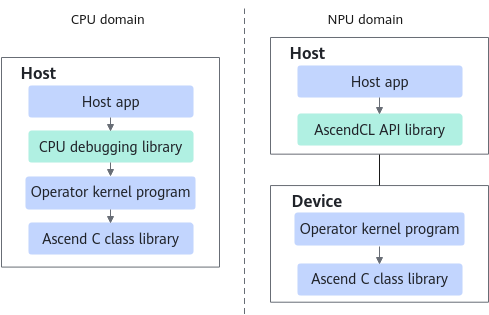

> **Official CANN 9.0.X source reading copy.** [English/Chinese counterpart](../zh/cpu_twin_debugging.md); [official page](https://www.hiascend.com/document/detail/en/CANNCommunityEdition/900/programug/Ascendcopdevg/atlas_ascendc_10_0073.html); [unaltered source body](../raw/a9661f37008bfa90.html). HTML formatting and image paths are converted for offline reading; no local technical corrections.

<a name="EN-US_TOPIC_0000002562442139"></a><a name="EN-US_TOPIC_0000002562442139"></a> 

# CPU Twin Debugging

This section describes how to debug the CPU domain: kernel function verification on the CPU, GDB debugging, and printing using the **printf** command. Currently, the SIMT programming scenario is not supported.


During CPU debugging, configuring log-related environment variables can help you record program running processes and exceptions, and debug functions.

For details about the restrictions and description of environment variables, see [Logging](https://www.hiascend.com/document/detail/en/CANNCommunityEdition/900/maintenref/envvar/envref_07_0118.html).

#### Verifying the Kernel Function on the CPU

On a non-Ascend device, you can use the CPU simulation environment to develop and test operators, and then use the Ascend device for accelerated computation after the operators are ready. In [Compilation and Running](https://www.hiascend.com/doc_center/source/en/CANNCommunityEdition/900/programug/Ascendcopdevg/atlas_ascendc_10_00042.html), we have introduced the compilation and running of the operator kernel program in the NPU domain. Compared with the operator running logic in the NPU domain, the operator kernel program is compiled as a host program in the CPU domain. In this case, the operator kernel program is linked to the CPU debugging library, and the executable file generated after compilation is executed to verify the running of the operator in the CPU domain. The running program on the CPU is debugged step by step by using the GDB general debugging tool. This can accurately verify whether the program execution process meets the expectation.

 **Figure 1 **Comparison of the kernel function running logic between the CPU and NPU domains 



The CMake compilation mode is recommended, which can quickly enable the twin debugging function in the CPU domain with minimal modifications.

- To enable debugging in the CPU domain, include the **cpu_debug_launch.h** header file. 

 In CPU debugging mode, the BiSheng compiler escapes the process of calling the kernel function using **<<<>>>**, implementing call of the kernel function in the CPU domain. The related call function is defined in **cpu_debug_launch.h**. In the source file of calling the kernel function using the **<<<>>>** syntax, include the required header file in the following way: 

```cpp
#ifdef ASCENDC_CPU_DEBUG
#include "cpu_debug_launch.h"
#endif
```

- Pass the variables **CMAKE_ASC_RUN_MODE** and **CMAKE_ASC_ARCHITECTURES** in the CMake configuration phase to enable CPU domain compilation. The following is a command example: 

```cpp
cmake -B build -DCMAKE_ASC_RUN_MODE=cpu -DCMAKE_ASC_ARCHITECTURES=dav-2201
```

**cpu** indicates to enable CPU domain compilation. The string following **dav-** is the NPU architecture version. Replace the string with the actual architecture version number.

For details about how to configure other items in **CMakeLists.txt**, see [Compilation Using CMake](https://www.hiascend.com/doc_center/source/en/CANNCommunityEdition/900/programug/Ascendcopdevg/atlas_ascendc_10_00039.html).


To unify the code in the CPU and NPU domains, the framework adapts only a proportion of ACL APIs in the CPU domain. When using the CPU domain debugging function, you can use only the following ACL APIs and cannot link the AscendCL library.

- APIs with actual functions and callable in the CPU domain 

- **aclDataTypeSize**, **aclFloat16ToFloat**, and **aclFloatToFloat16**

- **aclrtMalloc**, **aclrtFree**, **aclrtMallocHost**, **aclrtFreeHost**, **aclrtMemset**, **aclrtMemsetAsync**, **aclrtMemcpy**, **aclrtMemcpyAsync**, **aclrtMemcpy2d**, **aclrtMemcpy2dAsync**, **aclrtCreateContext**, and **aclrtDestroyContext**

- APIs without actual functions, which are implemented through stubs 

- Profile data collection 

<a name="EN-US_TOPIC_0000002562442139__li2852942164218"></a><a name="li2852942164218"></a>**aclprofInit**, **aclprofSetConfig**, **aclprofStart**, **aclprofStop**, and **aclprofFinalize**

- System configuration 

<a name="EN-US_TOPIC_0000002562442139__li1385214264217"></a><a name="li1385214264217"></a>**aclInit**, **aclFinalize**, and **aclrtGetVersion**

- Runtime management 

<a name="EN-US_TOPIC_0000002562442139__li178528425428"></a><a name="li178528425428"></a>**aclrtSetDevice**, **aclrtResetDevice**, **aclrtCreateStream**, **aclrtCreateStreamWithConfig**, **aclrtDestroyStream**, **aclrtDestroyStreamForce**, **aclrtSynchronizeStream**, **aclrtCreateContext**, and **aclrtDestroyContext**

#### GDB Debugging

You can use GDB to debug the operator computation precision step by step. The CPU debugging has been changed to multi-process debugging, and each core starts over an independent subprocess. Therefore, the GDB needs to be changed to the subprocess debugging mode. For the coupled architecture, each AI Core starts one subprocess. For the decoupled architecture, each AI Core starts three subprocesses (one Cube core and two Vector cores) by default.

- Debug a single subprocess. 

<a name="EN-US_TOPIC_0000002562442139__en-us_topic_0000001457309966_li1379314003611"></a><a name="en-us_topic_0000001457309966_li1379314003611"></a>Start GDB. In the example, **add_custom_cpu** is the executable file of the operator in the CPU domain. Set **run-mode** in the one-click compilation and running script to **cpu** by referring to [Modifying and Executing the Script for One-Click Compilation and Running](https://www.hiascend.com/doc_center/source/en/CANNCommunityEdition/900/programug/Ascendcopdevg/atlas_ascendc_10_0056.html#EN-US_TOPIC_0000002531522228__section188001652105215) to compile and generate the executable file of the operator in the CPU domain.

 After GDB is started, set the tracing subprocess and then set breakpoints. The program will stay in the subprocess. However, with this method, the program stays only in the first subprocess that encounters a breakpoint, and other subprocesses and the main process continue to execute until they exit. Operators involving inter-core synchronization cannot be debugged using this method. 

```cpp
gdb --args add_custom_cpu  // Start the GDB. add_custom_cpu is the executable file of the operator.
(gdb) set follow-fork-mode child
```

- Debug multiple subprocesses. 

<a name="EN-US_TOPIC_0000002562442139__en-us_topic_0000001457309966_li17465575361"></a><a name="en-us_topic_0000001457309966_li17465575361"></a>If inter-core synchronization is involved, multiple subprocesses need to be debugged in parallel.

After the GDB is started, set the debugging mode to debug only one process and suspend other processes. The command is as follows:

```cpp
(gdb) set detach-on-fork off
```

Run the following command to view the current debugging mode:

```cpp
(gdb) show detach-on-fork
```

The GDB program captures and interrupts the fork event. In this way, the GDB program can be interrupted each time a subprocess is started. The command is as follows:

```cpp
(gdb) catch fork
```

After **r** is executed, you can view the current process information.

```cpp
(gdb) info inferiors
  Num  Description
* 1    process 19613
```

When the **fork** command is executed for the first time, the program is disconnected from the fork position of the main process, and the subprocess is not generated.

After **c** is executed, check **info inferiors** again. You can see that the first subprocess is started.

```cpp
(gdb) info inferiors
  Num  Description 
* 1    process 19613
  2    process 19626
```

In this case, you can switch to the second process, that is, the first subprocess, and then add a breakpoint for debugging. In this case, the main process is suspended.

```cpp
(gdb) inferior 2
[Switching to inferior 2 [process 19626] ($HOME/demo)]
(gdb) info inferiors
  Num  Description
  1    process 19613
* 2    process 19626
```

Note that the number following **inferior** is the sequence number of the process, not the process number.

If synchronization is blocked, you can switch back to the main process to continue generating subprocesses, and then switch to a new subprocess for debugging. After the synchronization conditions are met, switch back to the first subprocess to continue execution.

The following is an example of commands for debugging a single subprocess:

```cpp
gdb --args add_custom_cpu
set follow-fork-mode child
break add_custom.cpp:45
run
list
backtrace
print i
break add_custom.cpp:56
continue
display xLocal
quit
```

#### printf

 Compile **printf(...)** in the code to observe the value output. The sample code is as follows: 

```cpp
printf("xLocal size: %d\n", xLocal.GetSize()); 
printf("tileLength: %d\n", tileLength);
```

 **Parent topic:** [Function Debugging](https://www.hiascend.com/doc_center/source/en/CANNCommunityEdition/900/programug/Ascendcopdevg/atlas_ascendc_10_00058.html)
