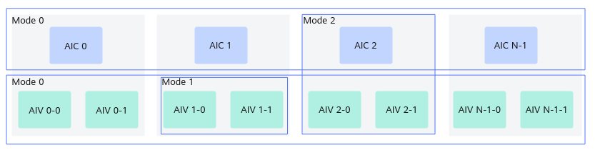

> **Official CANN 9.0.X source reading copy.** [English/Chinese counterpart](../zh/cross_core_setflag.md); [official page](https://www.hiascend.com/document/detail/en/CANNCommunityEdition/900/API/ascendcopapi/atlasascendc_api_07_0273.html); [unaltered source body](../raw/e94a412289da05e2.html). HTML formatting and image paths are converted for offline reading; no local technical corrections.

<a name="EN-US_TOPIC_0000002531381318"></a><a name="EN-US_TOPIC_0000002531381318"></a> 

# CrossCoreSetFlag (ISASI)

#### Applicability

<table>
      <thead>
       <tr>
        <th>
         <p><span>Product</span></p></th>
        <th>
         <p>Supported</p></th>
       </tr>
      </thead>
      <tbody>
       <tr>
        <td>
         <p><span>Atlas 350 Accelerator Card</span></p></td>
        <td>
         <p>√</p></td>
       </tr>
       <tr>
        <td>
         <p><span>
            Atlas A3 training product
           /
            Atlas A3 inference product
           </span></p></td>
        <td>
         <p>√</p></td>
       </tr>
       <tr>
        <td>
         <p><span>
            Atlas A2 training product
           /
            Atlas A2 inference product
           </span></p></td>
        <td>
         <p>√</p></td>
       </tr>
       <tr>
        <td>
         <p><span>
            Atlas 200I/500 A2 inference product
           </span></p></td>
        <td>
         <p>x</p></td>
       </tr>
       <tr>
        <td>
         <p><span>
            Atlas inference product
            AI Core</span></p></td>
        <td>
         <p>x</p></td>
       </tr>
       <tr>
        <td>
         <p><span>
            Atlas inference product
            Vector Core</span></p></td>
        <td>
         <p>x</p></td>
       </tr>
       <tr>
        <td>
         <p><span>
            Atlas training product
           </span></p></td>
        <td>
         <p>x</p></td>
       </tr>
      </tbody>
     </table>

#### Function Usage

Sets the inter-core synchronization control for the separate mode.

This API works with [CrossCoreWaitFlag](https://www.hiascend.com/doc_center/source/en/CANNCommunityEdition/900/API/ascendcopapi/atlasascendc_api_07_0274.html). The inter-core synchronization flag ID (**flagId**) needs to be passed. Each ID corresponds to a counter for controlling synchronization.

The synchronization control has the following modes, as shown in [Figure 1](https://www.hiascend.com/doc_center/source/en/CANNCommunityEdition/900/API/ascendcopapi/atlasascendc_api_07_0273.html#EN-US_TOPIC_0000002531381318__fig37581010773).

- Mode 0: synchronization control between AI Cores. In the AIC scenario, all AIC cores are synchronized. The subsequent instructions of **CrossCoreWaitFlag** are executed only when all AIC cores execute **CrossCoreSetFlag**. In the AIV scenario, all AIV cores are synchronized. The subsequent instructions of **CrossCoreWaitFlag** are executed only when all AIV cores execute **CrossCoreSetFlag**.

- Mode 1: synchronization control between AIV cores in the AI Core. The subsequent instructions of **CrossCoreWaitFlag** are executed only when both AIV cores run **CrossCoreSetFlag**.

- Mode 2: synchronization control between AIC and AIV cores in the AI Core. The subsequent instructions of **CrossCoreWaitFlag** on the two AIV cores are executed only after **CrossCoreSetFlag** is executed on the AIC core, and vice versa.

- Mode 4: synchronization control between AIC and AIV cores in the AI Core. AIV0 and AIV1 can trigger AIC wait independently. For example, the subsequent instructions of **CrossCoreWaitFlag** on AIV0 are executed only after the AIC core executes **CrossCoreSetFlag**, and vice versa.

Mode 4 is supported only by the Atlas 350 Accelerator Card.

 <a name="EN-US_TOPIC_0000002531381318__fig37581010773"></a><a name="fig37581010773"></a>**Figure 1 **Synchronization control modes 



#### Prototype

```cpp
template <uint8_t modeId, pipe_t pipe>
__aicore__ inline void CrossCoreSetFlag(uint16_t flagId)
```

#### Parameters

<table>

       <b>Table 1 </b>Template parameters

      <thead>
       <tr>
        <th>
         <p>Parameter</p></th>
        <th>
         <p>Description</p></th>
       </tr>
      </thead>
      <tbody>
       <tr>
        <td>
         <p>modeId</p></td>
        <td>
         <p>Inter-core synchronization mode. The options are as follows:</p>
         <ul>
          <li>Mode 0: synchronization control between AI Cores.</li>
          <li>Mode 1: synchronization control between AIV cores in the AI Core.</li>
          <li>Mode 2: synchronization control between AIC and AIV cores in the AI Core.</li>
          <li>Mode 4: synchronization control between AIC and AIV cores in the AI Core. AIV0 and AIV1 can trigger AIC wait independently.</li>
         </ul></td>
       </tr>
       <tr>
        <td>
         <p>pipe</p></td>
        <td>
         <p>The pipeline type of the instruction. For details about the pipeline types, see <a href="https://www.hiascend.com/doc_center/source/en/CANNCommunityEdition/900/API/ascendcopapi/atlasascendc_api_07_0179.html#EN-US_TOPIC_0000002531541438__section1272612276459">Pipelines</a>.</p>
         <p>Note that the <strong>PIPE_S</strong> type is supported only by the <span>Atlas 350 Accelerator Card</span>.</p></td>
       </tr>
      </tbody>
     </table>

<table>

       <b>Table 2 </b>Parameters

      <thead>
       <tr>
        <th>
         <p>Parameter</p></th>
        <th>
         <p>Input/Output</p></th>
        <th>
         <p>Description</p></th>
       </tr>
      </thead>
      <tbody>
       <tr>
        <td>
         <p>flagId</p></td>
        <td>
         <p>Input</p></td>
        <td>
         <p>Flag ID of the inter-core synchronization.</p>
         <p>For the <span>
            Atlas A2 training product
           /
            Atlas A2 inference product
           </span>, the value ranges from 0 to 10.</p>
         <p>For the <span>
            Atlas A3 training product
           /
            Atlas A3 inference product
           </span>, the value ranges from 0 to 10.</p>
         <p>For the <span>Atlas 350 Accelerator Card</span>, the value ranges are as follows:</p>
         <p>The operations with flag IDs 0 to 10 in <strong>CrossCoreSetFlag</strong> initiated by AIV0 correspond to the operations with flag IDs 0 to 10 in <strong>CrossCoreWaitFlag</strong> on the AIC.</p>
         <p>The operations with flag IDs 0 to 10 in <strong>CrossCoreSetFlag</strong> initiated by AIV1 correspond to the operations with flag IDs 16 to 26 in <strong>CrossCoreWaitFlag</strong> on the AIC.</p>
         <p>The operations with flag IDs 0 to 10 in <strong>CrossCoreSetFlag</strong> initiated by AIC correspond to the operations with flag IDs 0 to 10 in <strong>CrossCoreWaitFlag</strong> on AIV0.</p>
         <p>The operations with flag IDs 16 to 26 in <strong>CrossCoreSetFlag</strong> initiated by AIC correspond to the operations with flag IDs 0 to 10 in <strong>CrossCoreWaitFlag</strong> on AIV1.</p></td>
       </tr>
      </tbody>
     </table>

#### Returns

None

#### Constraints

- When using this synchronization API, you need to [set the kernel type](https://www.hiascend.com/doc_center/source/en/CANNCommunityEdition/900/API/ascendcopapi/atlasascendc_api_07_0218.html) according to the following rules: 

- In pure vector or cube scenarios, set the kernel type to **KERNEL_TYPE_MIX_AIV_1_0** or **KERNEL_TYPE_MIX_AIC_1_0**.

- In vector and cube fused scenarios, set the kernel type based on the actual situation.

- This API is used to control inter-core synchronization in the internal implementation of the [Matmul high-level API](https://www.hiascend.com/doc_center/source/en/CANNCommunityEdition/900/API/ascendcopapi/atlasascendc_api_07_0612.html). Therefore, you are not advised to use this API and the Matmul high-level API at the same time. Otherwise, flag IDs may conflict.

- The counter of the same **flagId** can be set for a maximum of 15 times.

- When using mode 0 of this API, you are advised to enable the batch mode so that an operator exclusively occupies all required core resources. Otherwise, a deadlock may occur if the following conditions are met: 

- Multi-stream concurrency scenarios (≥ 2 execution streams)

- Concurrent execution of at least two operators.

- The total number of cores of all concurrent operators exceeds the number of physical cores.

- Two or more concurrent operators use inter-core synchronization.

Specifically, in a multi-stream scenario, although n physical cores are allocated to an inter-core synchronization operator of a stream, only (n – m) cores may be scheduled and executed first, and remaining m cores are not started because they are preempted by inter-core synchronization operators of other streams. When the first started (n – m) cores reach inter-core synchronization, they wait for the remaining m cores to complete execution. However, the remaining m cores are occupied by the inter-core synchronization operators of other streams and cannot be released, resulting in a deadlock.

In kernel direct debugging scenarios, use the [__schedmode__(mode)](https://www.hiascend.com/document/detail/en/CANNCommunityEdition/900/programug/Ascendcopdevg/atlas_ascendc_10_10053.html#EN-US_TOPIC_0000002531362270__li1365012910475) qualifier to set the batch mode. In project-based operator development scenarios, use the **SetScheduleMode** API of TilingContext to set the batch mode. For details, see [Basic Data Structures and API List](https://www.hiascend.com/document/detail/en/CANNCommunityEdition/900/maintenref/basicdataapi/atlasopapi_07_00001.html).

 <a name="EN-US_TOPIC_0000002531381318__section837496171220"></a><a name="section837496171220"></a> 

#### Example

```cpp
// Synchronize all AIV cores in mode 0.
if (g_coreType == AscendC::AIV) {
    AscendC::CrossCoreSetFlag<0x0, PIPE_MTE3>(0x8);
    AscendC::CrossCoreWaitFlag(0x8);
}

// Synchronize all AIV cores in the AI Core in mode 1.
if (g_coreType == AscendC::AIV) {
    AscendC::CrossCoreSetFlag<0x1, PIPE_MTE3>(0x8);
    AscendC::CrossCoreWaitFlag(0x8);
}

// Note that if the high-level API is called, you do not need to process the synchronization between the AIC and AIV cores.
// Take Matmul as an example. The AIC core instructs the AIV to perform subsequent processing after completing the Matmul computation.
if (g_coreType == AscendC::AIC) {
    // Matmul computation
    AscendC::CrossCoreSetFlag<0x2, PIPE_FIX>(0x8);
}

// The AIV waits for the AIC Set message and performs subsequent processing.
if (g_coreType == AscendC::AIV) {
    AscendC::CrossCoreWaitFlag(0x8);
    // Subsequent AIV processing.
}
```

 **Parent topic:** [Inter-Core Synchronization](https://www.hiascend.com/doc_center/source/en/CANNCommunityEdition/900/API/ascendcopapi/atlasascendc_api_07_0268.html)
