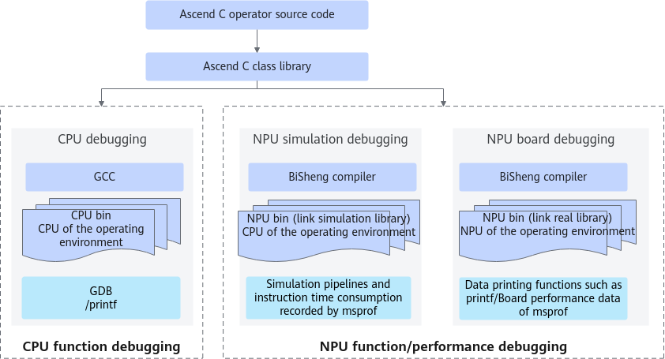

> **Official CANN 9.0.X source reading copy.** [English/Chinese counterpart](../zh/debugging_overview.md); [official page](https://www.hiascend.com/document/detail/en/CANNCommunityEdition/900/programug/Ascendcopdevg/atlas_ascendc_10_0072.html); [unaltered source body](../raw/e6de3fa2598ea596.html). HTML formatting and image paths are converted for offline reading; no local technical corrections.

 

# Overview

To debug an Ascend C operator, you need to first call the Ascend C class library to compile the kernel source code of the Ascend C operator, compile the kernel source code by using the GCC to generate common binary files on the CPU, and use the GDB debugging tool for debugging. In addition, you need to compile the kernel source code by using the BiSheng compiler to generate binary files on the NPU. You can use APIs such as **printf**/**assert** to print data, and use the simulation dotting or Profiling tool to collect board data for debugging.

The following table lists the debugging and tuning methods and tools.

<table><b>Table 1 </b>Debugging and tuning methods and tools<thead><tr><th>
Category

</th>
<th>
Subcategory

</th>
<th>
Method

</th>
</tr>
</thead>
<tbody><tr><td rowspan="5">
Function debugging

</td>
<td>
CPU twin debugging

</td>
<td>
<strong>Twin debugging</strong>: The same operator code can be used to debug accuracy on the CPU and performance on the NPU. In the CPU domain, you can perform GDB debugging and use the <strong>printf</strong> command to print information.

</td>
</tr>
<tr><td rowspan="4">
Board debugging on the NPU

</td>
<td>
<strong>printf</strong>/<strong>assert</strong>: <strong>printf</strong> is used to print scalar and string information. <strong>assert</strong> is used to set checkpoints in the code. When a condition is not met, the program terminates immediately and reports an error.

</td>
</tr>
<tr><td>
<strong>DumpTensor</strong>: Use the <strong>DumpTensor</strong> API to print the data of a specified tensor. It is supported only in SIMD programming scenarios.

</td>
</tr>
<tr><td>
<strong>Board debugging tool</strong>: Use the msDebug tool to debug the operator program running on the NPU. In a real hardware environment, test the input and output of the operator to verify whether the operator functions properly. The specific functions include setting breakpoints, printing variables and memory, performing single-step debugging, and interrupting execution. Currently, the SIMT programming scenario is not supported.

</td>
</tr>
<tr><td>
<strong>Memory check tool</strong>: Use the msSanitizer tool to check the memory. It can detect and report memory access exceptions such as out-of-bounds and misalignment of the external storage (global memory) and internal storage (local memory) during operator running.

</td>
</tr>
<tr><td>
Performance tuning

</td>
<td>
-

</td>
<td>
<strong>msProf tool</strong>:

The msProf performance analysis tool is used to collect and analyze key performance metrics of operators running on AI processors. You can efficiently locate software and hardware performance bottlenecks of operators based on the output performance data, thereby enhancing the overall efficiency of operator performance analysis.

Performance data can currently be collected and automatically parsed based on various running modes (onboard or simulation) and file formats (executable files or operator binary <strong>.o</strong> files).

</td>
</tr>
</tbody>
</table>

**Parent topic:** [Debugging and Tuning](https://www.hiascend.com/doc_center/source/en/CANNCommunityEdition/900/programug/Ascendcopdevg/atlas_ascendc_10_0071.html)
