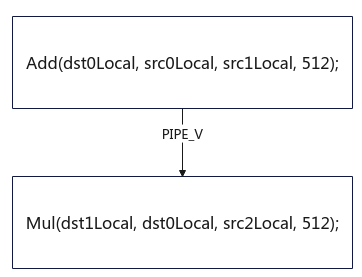

> **Official CANN 9.0.X source reading copy.** [English/Chinese counterpart](../zh/pipe_barrier.md); [official page](https://www.hiascend.com/document/detail/en/CANNCommunityEdition/900/API/ascendcopapi/atlasascendc_api_07_0271.html); [unaltered source body](../raw/af6dd6898eee46f6.html). HTML formatting and image paths are converted for offline reading; no local technical corrections.

<a name="EN-US_TOPIC_0000002531541240"></a><a name="EN-US_TOPIC_0000002531541240"></a> 

# PipeBarrier(ISASI)

#### Applicability

<table><thead><tr><th><p><span>Product</span></p>
</th>
<th><p>Supported</p>
</th>
</tr>
</thead>
<tbody><tr><td><p><span>Atlas 350 Accelerator Card</span></p>
</td>
<td><p>√</p>
</td>
</tr>
<tr><td><p><span>Atlas A3 training product/Atlas A3 inference product</span></p>
</td>
<td><p>√</p>
</td>
</tr>
<tr><td><p><span>Atlas A2 training product/Atlas A2 inference product</span></p>
</td>
<td><p>√</p>
</td>
</tr>
<tr><td><p><span>Atlas 200I/500 A2 inference product</span></p>
</td>
<td><p>√</p>
</td>
</tr>
<tr><td><p><span>Atlas inference product AI Core</span></p>
</td>
<td><p>√</p>
</td>
</tr>
<tr><td><p><span>Atlas inference product Vector Core</span></p>
</td>
<td><p>x</p>
</td>
</tr>
<tr><td><p><span>Atlas training product</span></p>
</td>
<td><p>√</p>
</td>
</tr>
</tbody>
</table>

#### Function Usage

Blocks a pipeline. This synchronization needs to be inserted between the same pipelines with data dependencies.

#### Prototype

```cpp
template <pipe_t pipe>
__aicore__ inline void PipeBarrier()
```

#### Parameters

<table><b>Table 1 </b>Template parameters<thead><tr><th><p>Parameter</p>
</th>
<th><p>Description</p>
</th>
</tr>
</thead>
<tbody><tr><td><p>pipe</p>
</td>
<td><p>Template parameter, indicating the type of a blocked pipeline.</p>
<p>For details about supported pipelines, see <a href="https://www.hiascend.com/doc_center/source/en/CANNCommunityEdition/900/API/ascendcopapi/atlasascendc_api_07_0179.html#EN-US_TOPIC_0000002531541438__section1272612276459">Pipelines</a>.</p>
<p>If you do not care about the pipeline type and want to block all pipelines, you can pass <strong>PIPE_ALL</strong>.</p>
</td>
</tr>
</tbody>
</table>

#### Returns

None

#### Constraints

The synchronization between Scalar pipelines is automatically ensured by the hardware. Calling **PipeBarrier<PIPE_S>()** throws a hardware error.

#### Example

In the following example, the input **dst0Local** of the Mul instruction is the output of the Add instruction. The two vector operation instructions depend on each other. Therefore, **PipeBarrier** needs to be inserted to ensure the execution sequence of the two instructions.

Note: This is only an example for reference. When automatic synchronization is enabled (enabled by default in kernel launch operator projects and custom operator development projects), the compiler automatically inserts the **PIPE_V** synchronization, and you do not need to manually insert it.

**Figure 1 **The Mul instruction and the Add instruction are in a serial relationship. The Mul instruction can be executed only after the Add instruction is executed.



```cpp
AscendC::LocalTensor<half> src0Local;
AscendC::LocalTensor<half> src1Local;
AscendC::LocalTensor<half> src2Local;
AscendC::LocalTensor<half> dst0Local;
AscendC::LocalTensor<half> dst1Local;

AscendC::Add(dst0Local, src0Local, src1Local, 512);
AscendC::PipeBarrier<PIPE_V>();
AscendC::Mul(dst1Local, dst0Local, src2Local, 512);
```

**Parent topic:** [Intra-Core Synchronization](https://www.hiascend.com/doc_center/source/en/CANNCommunityEdition/900/API/ascendcopapi/atlasascendc_api_07_00013.html)
