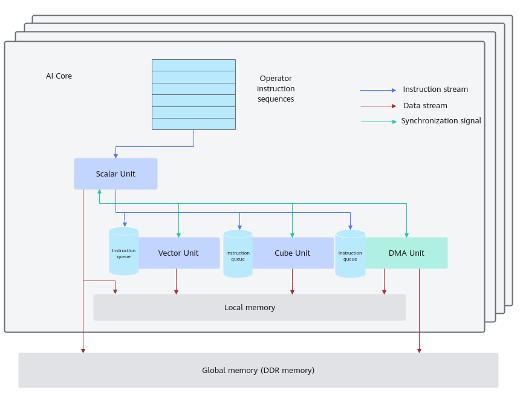
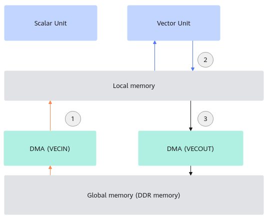
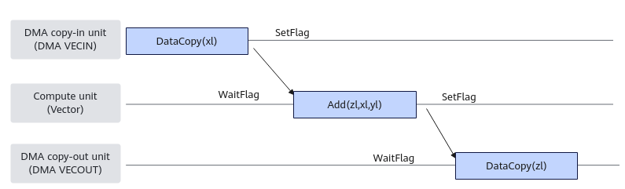
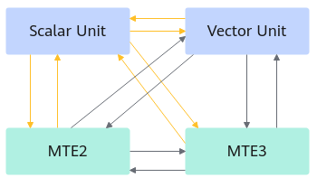

> **Official CANN 9.0.X source reading copy.** [English/Chinese counterpart](../zh/sync_control_overview.md); [official page](https://www.hiascend.com/document/detail/en/CANNCommunityEdition/900/API/ascendcopapi/atlasascendc_api_07_0179.html); [unaltered source body](../raw/2abbd75b3a08a4ce.html). HTML formatting and image paths are converted for offline reading; no local technical corrections.

 

# Introduction to Synchronization Control

You can use the synchronization control API to implement synchronization control. Generally, there is no need to consider synchronization when programming is based on the programming model and paradigms described in [Programming Model](https://www.hiascend.com/document/detail/en/CANNCommunityEdition/900/programug/Ascendcopdevg/atlas_ascendc_10_0012.html). The programming model implements synchronization control. Using programming model and paradigms is recommended. Manual synchronization control may increase programming complexity, which is not recommended. The difference between the [TQueSync](https://www.hiascend.com/doc_center/source/en/CANNCommunityEdition/900/API/ascendcopapi/atlasascendc_api_07_0178.html) APIs and the synchronization control APIs provided in [SetFlag/WaitFlag(ISASI)](https://www.hiascend.com/doc_center/source/en/CANNCommunityEdition/900/API/ascendcopapi/atlasascendc_api_07_0270.html) is that the APIs in [SetFlag/WaitFlag(ISASI)](https://www.hiascend.com/doc_center/source/en/CANNCommunityEdition/900/API/ascendcopapi/atlasascendc_api_07_0270.html) are of the ISASI type, which cannot guarantee compatibility across hardware versions, while the **TQueSync** APIs can.

#### Overview

Before getting to know synchronization control, you need to be familiar with the content in [Figure 1](https://www.hiascend.com/doc_center/source/en/CANNCommunityEdition/900/API/ascendcopapi/atlasascendc_api_07_0179.html#EN-US_TOPIC_0000002531541438__fig758422819442).

Asynchronous parallel computing process of the AI Core: The Scalar Unit reads the instruction sequence and issues the vector computation, matrix computation, and data transfer instructions to the instruction queues of other units. The Vector Unit, Cube Unit, and DMA units asynchronously execute the received instructions in parallel. See the instruction streams shown in blue arrows in [Figure 1](https://www.hiascend.com/doc_center/source/en/CANNCommunityEdition/900/API/ascendcopapi/atlasascendc_api_07_0179.html#EN-US_TOPIC_0000002531541438__fig758422819442).

Different instructions may depend on each other. To ensure that instructions in different instruction queues are executed based on the correct logic, the Scalar Unit also issues synchronization instructions to other units. For details about the synchronization process between units, see the synchronization signal streams shown in green arrows in [Figure 1](https://www.hiascend.com/doc_center/source/en/CANNCommunityEdition/900/API/ascendcopapi/atlasascendc_api_07_0179.html#EN-US_TOPIC_0000002531541438__fig758422819442).

The internal data processing of the AI Core is as follows: The DMA copy-in unit moves data to the local memory. The Vector/Cube Units complete data computation and write the computation result back to the local memory. And then, the DMA copy-out unit moves the processed data back to the global memory. See the red data flows in [Figure 1](https://www.hiascend.com/doc_center/source/en/CANNCommunityEdition/900/API/ascendcopapi/atlasascendc_api_07_0179.html#EN-US_TOPIC_0000002531541438__fig758422819442).

 **Figure 1 **Abstraction of the AI Core's internal parallel computation architecture 

As shown in the preceding figure, the execution units in the AI Core are asynchronously parallel. There might be a dependent relationship when the local memory is read or written, requiring synchronization control.

The following figure shows a common vector computation data stream:

- The DMA execution unit transfers data from the global memory to the local memory.

- Computation is performed.

- The DMA execution unit transfers the computation result from the local memory to the global memory.

The four execution units Scalar, Vector, DMA (VECIN), and DMA (VECOUT) are executed in parallel. If the same local memory is accessed, a synchronization mechanism is required to control the access timing. That is, data needs to be moved to the local memory for computation and then moved out after computation.

  

#### Pipelines

The following describes the parallel instruction pipelines in the AI Core.

The specific pipelines contained in each hardware pipeline type vary according to the hardware architecture. For details, see [Hardware Implementation](https://www.hiascend.com/document/detail/en/CANNCommunityEdition/900/programug/Ascendcopdevg/atlas_ascendc_10_0007.html).

  

<table>

       <b>Table 1 </b>Description of instruction pipelines

      <thead>
       <tr>
        <th>
         
Type
</th>
        <th>
         
Meaning
</th>
       </tr>
      </thead>
      <tbody>
       <tr>
        <td>
         
PIPE_S
</td>
        <td>
         
Scalar computation pipeline, which is used when <strong>Tensor GetValue</strong> is used.
</td>
       </tr>
       <tr>
        <td>
         
PIPE_V
</td>
        <td>
         
Vector computation pipeline and data transfer pipeline from <strong>L0C Buffer</strong> to <strong>UB</strong> in some hardware architectures.
</td>
       </tr>
       <tr>
        <td>
         
PIPE_M
</td>
        <td>
         
Matrix computation pipeline.
</td>
       </tr>
       <tr>
        <td>
         
PIPE_MTE1
</td>
        <td>
         
Data transfer pipeline from <strong>L1 Buffer</strong> to <strong>L0A Buffer</strong> and from <strong>L1 Buffer</strong> to <strong>L0B Buffer</strong>.
</td>
       </tr>
       <tr>
        <td>
         
PIPE_MTE2
</td>
        <td>
         
Data transfer pipeline from <strong>GM</strong> to <strong>L1 Buffer</strong>, from <strong>GM</strong> to <strong>UB</strong>, and more.
</td>
       </tr>
       <tr>
        <td>
         
PIPE_MTE3
</td>
        <td>
         
Data transfer pipeline from <strong>UB</strong> to <strong>GM</strong> and more.
</td>
       </tr>
       <tr>
        <td>
         
PIPE_FIX
</td>
        <td>
         
Data transfer pipeline from <strong>L0C Buffer</strong> to <strong>GM</strong>, from <strong>L0C Buffer</strong> to <strong>L1</strong>, and more.
</td>
       </tr>
      </tbody>
     </table>

#### Synchronization Control Classification

There are two types of parallel pipelines for synchronization control:

- Multi-pipeline synchronization: **SetFlag**/**WaitFlag** of the [TQueSync](https://www.hiascend.com/doc_center/source/en/CANNCommunityEdition/900/API/ascendcopapi/atlasascendc_api_07_0178.html) APIs or the APIs in [SetFlag/WaitFlag(ISASI)](https://www.hiascend.com/doc_center/source/en/CANNCommunityEdition/900/API/ascendcopapi/atlasascendc_api_07_0270.html) are called to control the synchronization between different pipelines. 

- **SetFlag**: The current instruction starts to be executed after all read and write operations of the current instruction are completed and the corresponding flag bit in hardware is set to **1**.

- **WaitFlag**: When this instruction is executed, if the corresponding flag bit is **0**, the subsequent instructions in the queue are blocked; if the corresponding flag bit is **1**, the subsequent instructions are executed after this bit is changed to **0**.

- Single-pipeline synchronization: [PipeBarrier(ISASI)](https://www.hiascend.com/doc_center/source/en/CANNCommunityEdition/900/API/ascendcopapi/atlasascendc_api_07_0271.html) is called to implement synchronization control in a single pipeline to restrict the execution sequence. This ensures that instructions after the barrier cannot issue until all instructions before the barrier are committed.

  

#### Requirements on Enabling Manual Synchronization Control

- Vector Unit 

- Single-pipeline synchronization: For **PIPE_V**, synchronization is automatically inserted by the compiler. If the movement addresses of **PIPE_MTE2**/**PIPE_MTE3** overlap, you need to insert synchronization. For details, see [precautions](https://www.hiascend.com/doc_center/source/en/CANNCommunityEdition/900/API/ascendcopapi/atlasascendc_api_07_0103.html#EN-US_TOPIC_0000002562301699__li71531626153617).

- Multi-pipeline synchronization: The multi-pipeline synchronization between **PIPE_V**, **PIPE_MTE2**, **PIPE_MTE3**, and **PIPE_S** is bidirectional. As shown in the following figure, the yellow arrows indicate that synchronization is automatically inserted by the compiler, and the remaining synchronization is completed by the Ascend C framework. Exception: When an atomic operation API (such as [AtomicAdd](https://www.hiascend.com/doc_center/source/en/CANNCommunityEdition/900/API/ascendcopapi/atlasascendc_api_07_00259.html)) involving scalar computation is used, if the scalar computation unit and the **MTE2**/**MTE3** have data dependencies when reading and writing the global memory, you need to insert synchronization based on the actual situation. For details, see the API description. 

- Cube Unit 

All pipeline synchronization on the Cube is completed by the Ascend C framework. You do not need to manually insert synchronization.

The synchronization inserted automatically by the compiler strongly depends on local tensors. In some scenarios, you need to manually complete the synchronization. For details about the restrictions, see [BiSheng Compiler](https://www.hiascend.com/document/detail/en/CANNCommunityEdition/900/compiler/BishengCompiler/atlas_bisheng_10_0001.html).

 **Parent topic:** [Intra-Core Synchronization](https://www.hiascend.com/doc_center/source/en/CANNCommunityEdition/900/API/ascendcopapi/atlasascendc_api_07_00013.html)
