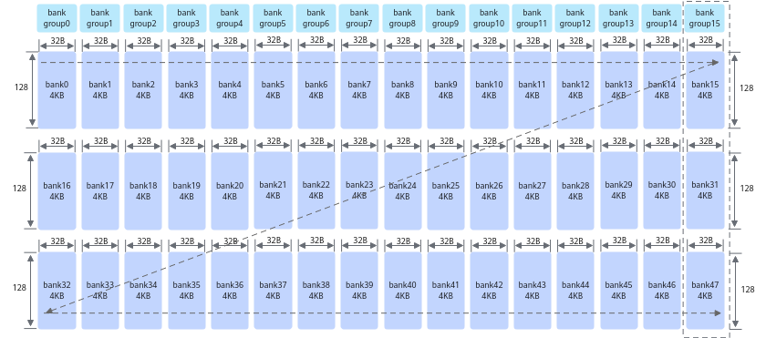

> **Official CANN 9.0.X source reading copy.** [English/Chinese counterpart](../en/bank_conflicts_220x.md); [official page](https://www.hiascend.com/document/detail/zh/CANNCommunityEdition/900/programug/Ascendcopdevg/atlas_ascendc_best_practices_10_00020.html); [unaltered source body](../raw/280be4665a5b3228.html). HTML formatting and image paths are converted for offline reading; no local technical corrections.

 

# 避免bank冲突（NPU架构版本220x）

【优先级】高

该性能优化建议适用于如下产品型号：

- Atlas A3 训练系列产品 / Atlas A3 推理系列产品

- Atlas A2 训练系列产品 / Atlas A2 推理系列产品

【描述】为了提高数据访问的效率和吞吐量，Unified Buffer采用了bank（大小相等的内存模块）结构设计。Unified Buffer总大小为192K，划分为48个bank。每个bank由128行组成，每行长度为32B。这48个bank进一步组织为16个bank group，每个bank group包含3个bank，例如bank15、bank31和bank47组成一个bank group。

 **图1 **bank结构示意图（图中箭头方向表示内存排布的顺序） 

每个bank可以独立地进行数据的读写操作，允许多个数据请求同时进行。然而，当多个读写操作试图同时访问同一个bank或bank group时，由于硬件资源的限制，这些操作必须排队等待，会导致bank冲突，引起性能下降。

具体来说，Vector计算单元每拍（一个指令周期）能够从每个bank group中读取或写入一行数据。如果同一个API中的多个操作试图同时访问同一个bank或bank group，Vector计算单元无法在同一个周期内处理所有请求，导致这些请求排队等待。这种排队增加了数据访问的延迟，降低了系统的整体性能。

#### bank冲突的典型场景

bank冲突主要可以分为以下三种场景：

- **读写冲突**：读操作和写操作同时尝试访问同一个bank。

- **写写冲突**：多个写操作同时尝试访问同一个bank group。

- **读读冲突**：多个读操作同时尝试访问同一个bank group。

下文给出了一些具体的示例，假设，0x10000地址在bank16上，0x10020在bank17上，0x20020在bank33上，如下图所示：

 **图2 **地址分配示意图 

- 读写冲突示例 

 Vector指令的源操作数src和目的操作数dst同时读写到同一个bank时造成读写冲突，具体分析如下： 

<table>

          <b>表1 </b>读写冲突示例

         <thead>
          <tr>
           <th>
            
序号
</th>
           <th>
            
src地址
</th>
           <th>
            
dst地址
</th>
           <th>
            
bank
</th>
           <th>
            
bank group
</th>
           <th>
            
结论
</th>
          </tr>
         </thead>
         <tbody>
          <tr>
           <td>
            
示例1
</td>
           <td>
            
0x10020
</td>
           <td>
            
0x10000
</td>
           <td>
            
bank_id0 != bank_id1
</td>
           <td>
            
bank_group_id0 != bank_group_id1
</td>
           <td>
            
src地址和dst地址分别属于bank16和bank17，故无冲突。
</td>
          </tr>
          <tr>
           <td>
            
示例2
</td>
           <td>
            
0x10020
</td>
           <td>
            
0x10E20
</td>
           <td>
            
bank_id0 == bank_id1
</td>
           <td>
            
bank_group_id0 == bank_group_id1
</td>
           <td>
            
src地址和dst地址的地址都在bank17，故存在冲突。
</td>
          </tr>
         </tbody>
        </table>

- 写写冲突示例 

 Vector指令目的操作数dst对应的8个DataBlock（block0-block7）同时写到一个bank group时造成写写冲突，具体分析如下： 

<table>

          <b>表2 </b>写写冲突示例

         <thead>
          <tr>
           <th>
            
序号
</th>
           <th>
            
dst地址
</th>
           <th>
            
blk_stride
</th>
           <th>
            
block0_addr
</th>
           <th>
            
block1_addr
</th>
           <th>
            
block2_addr
</th>
           <th>
            
...
</th>
           <th>
            
结论
</th>
          </tr>
         </thead>
         <tbody>
          <tr>
           <td>
            
示例1
</td>
           <td>
            
0x1FE00
</td>
           <td>
            
16
</td>
           <td>
            
0x1FE00
</td>
           <td>
            
0x20000
</td>
           <td>
            
0x20200
</td>
           <td>
            
...
</td>
           <td>
            
8个DataBlock均在一个bank group下，故全部冲突，8拍完成一个Repeat的写入。
</td>
          </tr>
          <tr>
           <td>
            
示例2
</td>
           <td>
            
0x1FE00
</td>
           <td>
            
8
</td>
           <td>
            
0x1FE00
</td>
           <td>
            
0x1FF00
</td>
           <td>
            
0x20000
</td>
           <td>
            
...
</td>
           <td>
            
block0和block2在一个bank group，存在冲突，4拍完成一个Repeat的写入。
</td>
          </tr>
         </tbody>
        </table>

- 读读冲突 

- Vector指令多个源操作数同时读到同一个bank group时造成读读冲突，具体分析如下： 

<table>

           <b>表3 </b>双src场景读读冲突示例

          <thead>
           <tr>
            <th>
             
序号
</th>
            <th>
             
src0地址
</th>
            <th>
             
src1地址
</th>
            <th>
             
bank
</th>
            <th>
             
bank group
</th>
            <th>
             
结论
</th>
           </tr>
          </thead>
          <tbody>
           <tr>
            <td>
             
示例1
</td>
            <td>
             
0x10020
</td>
            <td>
             
0x20020
</td>
            <td>
             
bank_id0 != bank_id1
</td>
            <td>
             
bank_group_id0 == bank_group_id1
</td>
            <td>
             
存在冲突。
</td>
           </tr>
           <tr>
            <td>
             
示例2
</td>
            <td>
             
0x10020
</td>
            <td>
             
0x10000
</td>
            <td>
             
bank_id0 != bank_id1
</td>
            <td>
             
bank_group_id0 != bank_group_id1
</td>
            <td>
             
无冲突。
</td>
           </tr>
          </tbody>
         </table>

- Vector指令某一个源操作数对应的8个DataBlock（block0-block7）读到同一个bank group时造成读读冲突，具体分析如下： 

<table>

           <b>表4 </b>单src场景读读冲突示例

          <thead>
           <tr>
            <th>
             
序号
</th>
            <th>
             
src地址
</th>
            <th>
             
blk_stride
</th>
            <th>
             
block0_addr
</th>
            <th>
             
block1_addr
</th>
            <th>
             
block2_addr
</th>
            <th>
             
...
</th>
            <th>
             
结论
</th>
           </tr>
          </thead>
          <tbody>
           <tr>
            <td>
             
示例1
</td>
            <td>
             
0x1FE00
</td>
            <td>
             
16
</td>
            <td>
             
0x1FE00
</td>
            <td>
             
0x20000
</td>
            <td>
             
0x20200
</td>
            <td>
             
...
</td>
            <td>
             
8个DataBlock均在一个bank group下，故全部冲突，8拍完成一个Repeat的读操作。
</td>
           </tr>
           <tr>
            <td>
             
示例2
</td>
            <td>
             
0x1FE00
</td>
            <td>
             
8
</td>
            <td>
             
0x1FE00
</td>
            <td>
             
0x1FF00
</td>
            <td>
             
0x20000
</td>
            <td>
             
...
</td>
            <td>
             
block0和block2在同一个bank group下，存在冲突，4拍完成一个Repeat。
</td>
           </tr>
          </tbody>
         </table>

通过msProf工具可以进行资源冲突占比的相关性能数据采集。

工具的具体使用方法和资源冲突占比文件性能数据文件说明请参考《[算子开发工具](https://www.hiascend.com/document/detail/zh/CANNCommunityEdition/900/devaids/optool/docs/zh/quick_start/mskpp_quick_start.md)》。

#### 如何避免bank冲突

避免bank冲突的方法有两种：**优化计算逻辑**和**优化地址分配**。

- **优化计算逻辑** 

对一个shape为(8, 16, 16)的输入做(1, 0, 2)的transpose操作，输出shape为(16, 8, 16)。通过将计算逻辑由“跳读，连续写”修改为“连续读，跳写”可避免冲突问题。实现方案对比如下：

<table>
        <thead>
         <tr>
          <th>
           
实现方案
</th>
          <th>
           
原始实现
</th>
          <th>
           
优化实现
</th>
         </tr>
        </thead>
        <tbody>
         <tr>
          <td>
           
实现方法
</td>
          <td>
           
跳读，连续写

           
同一Repeat内输入的8个DataBlock都在同一个bank group而发生读读冲突。
</td>
          <td>
           
连续读，跳写

           
同一个Repeat内输入的8个DataBlock不在同一个bank group内，避免了读读冲突。
</td>
         </tr>
         <tr>
          <td>
           
示意图
</td>
          <td>
           

</td>
          <td>
           

</td>
         </tr>
         <tr>
          <td>
           
示例代码
</td>
          <td>

             <table>
              <tbody>
               <tr>
                <td>

                  <pre>1
2
3
4
5
6
7</pre>
                 </td>
                <td>

                  <pre>uint64_t mask = 128;
UnaryRepeatParams params;
params.dstBlkStride  = 1;
params.srcBlkStride = 16;
for(uint32_t i=0; i&lt;16; i++)   {
    AscendC::Adds(dstLocal[i * 128], srcLocal[i * 16], 0, mask, 1, params);
}
</pre>
                 </td>
               </tr>
              </tbody>
             </table>

           </td>
          <td>

             <table>
              <tbody>
               <tr>
                <td>

                  <pre>1
2
3
4
5
6
7</pre>
                 </td>
                <td>

                  <pre>uint64_t mask = 128;
UnaryRepeatParams params;
params.dstBlkStride  = 8;
params.srcBlkStride = 1;
for(uint32_t i=0; i&lt;8; i++)   {
    AscendC::Adds(dstLocal[i * 16], srcLocal[i * 256], 0, mask, 2, params);
}
</pre>
                 </td>
               </tr>
              </tbody>
             </table>

           </td>
         </tr>
        </tbody>
       </table>

- **优化地址分配** 

实现连续4096个float元素的加法z = x + y，通过在内存分配时适当扩大内存，保证在一个Repeat内，x和y不会同时出现在同一个bank group内，x/y和z不会同时出现同一个bank内。完整样例可参考[避免bank冲突样例](https://gitee.com/ascend/samples/tree/master/operator/ascendc/4_best_practices/4_bank_conflict)。

实现方案对比如下：

<table>
        <thead>
         <tr>
          <th>
           
实现方案
</th>
          <th>
           
原始实现
</th>
          <th>
           
优化实现
</th>
         </tr>
        </thead>
        <tbody>
         <tr>
          <td>
           
实现方法
</td>
          <td>
           
不做地址优化，直接使用InitBuffer分配内存，各个Tensor的地址分别为：

           
x：起始地址0x0，tensor长度为4096 * sizeof(float)字节

           
y：起始地址0x4000，tensor长度为4096 * sizeof(float)字节

           
z：起始地址0x8000，tensor长度为4096 * sizeof(float)字节

           
在一个Repeat内，x和y同时读同一个bank group，x/y和z同时读写同一个bank。
</td>
          <td>
           
优化地址，使用InitBuffer分配内存时适当扩大内存申请，各个Tensor的地址分别为：

           
x：起始地址0x0，tensor长度为(4096 * sizeof(float) + 256)字节

           
y：起始地址0x4100，tensor长度为(64 * 1024 - (4096 * sizeof(float) + 256))字节

           
z：起始地址0x10000，tensor长度为4096 * sizeof(float) 字节

           
x多申请256字节，避免一个Repeat内x y同时读同一个bank group；y多申请空间，确保z不会和x/y落入同一个bank
</td>
         </tr>
         <tr>
          <td>
           
示意图
</td>
          <td>
           

</td>
          <td>
           

</td>
         </tr>
         <tr>
          <td>
           
示例代码
</td>
          <td>

             <table>
              <tbody>
               <tr>
                <td>

                  <pre>1
2
3</pre>
                 </td>
                <td>

                  <pre>pipe.InitBuffer(inQueueX, 1, 4096 * sizeof(float));
pipe.InitBuffer(inQueueY, 1, 4096 * sizeof(float));
pipe.InitBuffer(outQueueZ, 1, 4096 * sizeof(float));
</pre>
                 </td>
               </tr>
              </tbody>
             </table>

           </td>
          <td>

             <table>
              <tbody>
               <tr>
                <td>

                  <pre>1
2
3</pre>
                 </td>
                <td>

                  <pre>pipe.InitBuffer(inQueueX, 1, 4096 * sizeof(float) + 256); // 多申请256字节
pipe.InitBuffer(inQueueY, 1, 64 * 1024 - (4096 * sizeof(float) + 256)); //多申请空间，确保z不会和x/y落入同一个bank， 64 * 1024是16个bank的空间，4096 * sizeof(float) + 256是x所占的空间
pipe.InitBuffer(outQueueZ, 1, 4096 * sizeof(float));
</pre>
                 </td>
               </tr>
              </tbody>
             </table>

           </td>
         </tr>
        </tbody>
       </table>

 **父主题：** [避免Unified Buffer的bank冲突](https://www.hiascend.com/doc_center/source/zh/CANNCommunityEdition/900/programug/Ascendcopdevg/atlas_ascendc_best_practices_10_0025.html)
