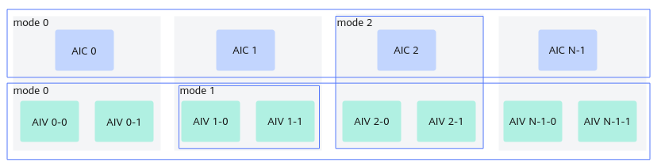

> **Official CANN 9.0.X source reading copy.** [English/Chinese counterpart](../en/cross_core_setflag.md); [official page](https://www.hiascend.com/document/detail/zh/CANNCommunityEdition/900/API/ascendcopapi/atlasascendc_api_07_0273.html); [unaltered source body](../raw/3fd9dd7988e9e197.html). HTML formatting and image paths are converted for offline reading; no local technical corrections.

<a name="ZH-CN_TOPIC_0000002531381318"></a><a name="ZH-CN_TOPIC_0000002531381318"></a> 

# CrossCoreSetFlag(ISASI)

#### 产品支持情况

<table>
      <thead>
       <tr>
        <th>
         <p><span>产品</span></p></th>
        <th>
         <p>是否支持</p></th>
       </tr>
      </thead>
      <tbody>
       <tr>
        <td>
         <p><span>Atlas 350 加速卡</span></p></td>
        <td>
         <p>√</p></td>
       </tr>
       <tr>
        <td>
         <p><span>
            Atlas A3 训练系列产品
           /
            Atlas A3 推理系列产品
           </span></p></td>
        <td>
         <p>√</p></td>
       </tr>
       <tr>
        <td>
         <p><span>
            Atlas A2 训练系列产品
           /
            Atlas A2 推理系列产品
           </span></p></td>
        <td>
         <p>√</p></td>
       </tr>
       <tr>
        <td>
         <p><span>
            Atlas 200I/500 A2 推理产品
           </span></p></td>
        <td>
         <p>x</p></td>
       </tr>
       <tr>
        <td>
         <p><span>
            Atlas 推理系列产品
           AI Core</span></p></td>
        <td>
         <p>x</p></td>
       </tr>
       <tr>
        <td>
         <p><span>
            Atlas 推理系列产品
           Vector Core</span></p></td>
        <td>
         <p>x</p></td>
       </tr>
       <tr>
        <td>
         <p><span>
            Atlas 训练系列产品
           </span></p></td>
        <td>
         <p>x</p></td>
       </tr>
      </tbody>
     </table>

#### 功能说明

面向分离模式的核间同步控制接口。

该接口和[CrossCoreWaitFlag](https://www.hiascend.com/doc_center/source/zh/CANNCommunityEdition/900/API/ascendcopapi/atlasascendc_api_07_0274.html)接口配合使用。使用时需传入核间同步的标记ID(flagId)，每个ID对应一个用于控制同步的计数器。

同步控制分为以下几种模式，如[图1](https://www.hiascend.com/doc_center/source/zh/CANNCommunityEdition/900/API/ascendcopapi/atlasascendc_api_07_0273.html#ZH-CN_TOPIC_0000002531381318__fig37581010773)所示：

- 模式0：AI Core核间的同步控制。对于AIC场景，同步所有的AIC核，直到所有的AIC核都执行到CrossCoreSetFlag时，CrossCoreWaitFlag后续的指令才会执行；对于AIV场景，同步所有的AIV核，直到所有的AIV核都执行到CrossCoreSetFlag时，CrossCoreWaitFlag后续的指令才会执行。

- 模式1：AI Core内部，AIV核之间的同步控制。如果两个AIV核都运行了CrossCoreSetFlag，CrossCoreWaitFlag后续的指令才会执行。

- 模式2：AI Core内部，AIC与AIV之间的同步控制。在AIC核执行CrossCoreSetFlag之后， 两个AIV上CrossCoreWaitFlag后续的指令才会继续执行；两个AIV都执行CrossCoreSetFlag后，AIC上CrossCoreWaitFlag后续的指令才能执行。

- 模式4：AI Core内部，AIC与AIV之间的同步控制。AIV0与AIV1可单独触发AIC等待。比如，在AIC核执行CrossCoreSetFlag之后， AIV0上CrossCoreWaitFlag后续的指令才会继续执行；AIV0执行CrossCoreSetFlag后，AIC上CrossCoreWaitFlag后续的指令才能执行。

其中，模式4仅支持Atlas 350 加速卡。

 <a name="ZH-CN_TOPIC_0000002531381318__fig37581010773"></a><a name="fig37581010773"></a>**图1 **同步控制模式示意图 



#### 函数原型

```cpp
template <uint8_t modeId, pipe_t pipe>
__aicore__ inline void CrossCoreSetFlag(uint16_t flagId)
```

#### 参数说明

<table>

       <b>表1 </b>模板参数说明

      <thead>
       <tr>
        <th>
         <p>参数名</p></th>
        <th>
         <p>描述</p></th>
       </tr>
      </thead>
      <tbody>
       <tr>
        <td>
         <p>modeId</p></td>
        <td>
         <p>核间同步的模式，取值如下：</p>
         <ul>
          <li>模式0：AI Core核间的同步控制。</li>
          <li>模式1：AI Core内部，Vector核（AIV）之间的同步控制。</li>
          <li>模式2：AI Core内部，Cube核（AIC）与Vector核（AIV）之间的同步控制。</li>
          <li>模式4：AI Core内部，AIC与AIV之间的同步控制。AIV0与AIV1可单独触发AIC等待。</li>
         </ul></td>
       </tr>
       <tr>
        <td>
         <p>pipe</p></td>
        <td>
         <p>设置这条指令所在的流水类型，流水类型可参考<a href="https://www.hiascend.com/doc_center/source/zh/CANNCommunityEdition/900/API/ascendcopapi/atlasascendc_api_07_0179.html#ZH-CN_TOPIC_0000002531541438__section1272612276459">硬件流水类型</a>。</p>
         <p>特别地，PIPE_S流水类型仅<span>Atlas 350 加速卡</span>支持。</p></td>
       </tr>
      </tbody>
     </table>

<table>

       <b>表2 </b>参数说明

      <thead>
       <tr>
        <th>
         <p>参数名</p></th>
        <th>
         <p>输入/输出</p></th>
        <th>
         <p>描述</p></th>
       </tr>
      </thead>
      <tbody>
       <tr>
        <td>
         <p>flagId</p></td>
        <td>
         <p>输入</p></td>
        <td>
         <p>核间同步的标记。</p>
         <p><span>
            Atlas A2 训练系列产品
           /
            Atlas A2 推理系列产品
           </span>，取值范围是0-10。</p>
         <p><span>
            Atlas A3 训练系列产品
           /
            Atlas A3 推理系列产品
           </span>，取值范围是0-10。</p>
         <p><span>Atlas 350 加速卡</span>，取值范围如下：</p>
         <p>AIV0发起的flagId 0-10的CrossCoreSetFlag操作对应AIC CrossCoreWaitFlag中flagId 0-10的操作。</p>
         <p>AIV1发起的flagId 0-10的CrossCoreSetFlag操作对应AIC CrossCoreWaitFlag中flagId 16-26的操作。</p>
         <p>AIC发起的flagId 0-10的CrossCoreSetFlag操作对应AIV0 CrossCoreWaitFlag中flagId 0-10的操作。</p>
         <p>AIC发起的flagId 16-26的CrossCoreSetFlag操作对应AIV1 CrossCoreWaitFlag中flagId 0-10的操作。</p></td>
       </tr>
      </tbody>
     </table>

#### 返回值说明

无

#### 约束说明

- 使用该同步接口时，需要按照如下规则[设置Kernel类型](https://www.hiascend.com/doc_center/source/zh/CANNCommunityEdition/900/API/ascendcopapi/atlasascendc_api_07_0218.html)： 

- 在纯Vector/Cube场景下，需设置Kernel类型为KERNEL_TYPE_MIX_AIV_1_0或KERNEL_TYPE_MIX_AIC_1_0。

- 对于Vector和Cube混合场景，需根据实际情况灵活配置Kernel类型。

- 因为[Matmul高阶API](https://www.hiascend.com/doc_center/source/zh/CANNCommunityEdition/900/API/ascendcopapi/atlasascendc_api_07_0612.html)内部实现中使用了本接口进行核间同步控制，所以不建议开发者同时使用该接口和Matmul高阶API，否则会有flagID冲突的风险。

- 同一flagId的计数器最多设置15次。

- 使用该接口模式0时，建议开启batchmode模式，使算子独占全部所需核资源，否则可能因满足以下条件导致死锁： 

- 多流并发场景（≥2条执行流）。

- ≥2个算子并发执行。

- 所有并发算子的核数总和超过物理核数。

- ≥2个并发算子使用了核间同步功能。

具体而言，在多流场景下，某条流的核间同步算子虽分配到n个物理核，但可能仅有n-m个核先被调度执行，而其余m个核因被其他流的核间同步算子抢占而尚未启动。先启动的n-m个核执行到核间同步时等待剩余m核完成，而剩余m核因被其他流的核间同步算子占用而无法释放，形成死锁。

Kernel直调场景下通过[__schedmode__(mode)](https://www.hiascend.com/document/detail/zh/CANNCommunityEdition/900/programug/Ascendcopdevg/atlas_ascendc_10_10053.html#ZH-CN_TOPIC_0000002531362270__li1365012910475)限定符来设置batchmode模式；工程化算子开发场景下，通过TilingContext的SetScheduleMode接口来设置batchmode模式，具体请参考[《基础数据结构和接口》](https://www.hiascend.com/document/detail/zh/CANNCommunityEdition/900/maintenref/basicdataapi/atlasopapi_07_00001.html)。

 <a name="ZH-CN_TOPIC_0000002531381318__section837496171220"></a><a name="section837496171220"></a> 

#### 调用示例

```cpp
// 使用模式0的方式同步所有的AIV核
if (g_coreType == AscendC::AIV) {
    AscendC::CrossCoreSetFlag<0x0, PIPE_MTE3>(0x8);
    AscendC::CrossCoreWaitFlag(0x8);
}

// 使用模式1的方式同步当前AICore内的所有AIV子核
if (g_coreType == AscendC::AIV) {
    AscendC::CrossCoreSetFlag<0x1, PIPE_MTE3>(0x8);
    AscendC::CrossCoreWaitFlag(0x8);
}

// 注意：如果调用高阶API,无需开发者处理AIC和AIV的同步
// 以Matmul为例：AIC侧做完Matmul计算后通知AIV进行后处理
if (g_coreType == AscendC::AIC) {
    // Matmul处理
    AscendC::CrossCoreSetFlag<0x2, PIPE_FIX>(0x8);
}

// AIV侧等待AIC Set消息, 进行Vector后处理
if (g_coreType == AscendC::AIV) {
    AscendC::CrossCoreWaitFlag(0x8);
    // Vector后处理
}
```

 **父主题：** [核间同步](https://www.hiascend.com/doc_center/source/zh/CANNCommunityEdition/900/API/ascendcopapi/atlasascendc_api_07_0268.html)
