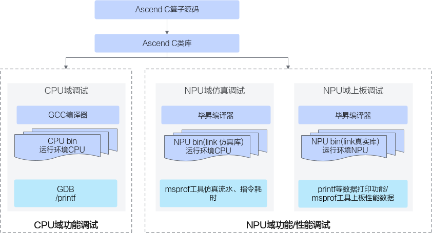

> **Official CANN 9.0.X source reading copy.** [English/Chinese counterpart](../en/debugging_overview.md); [official page](https://www.hiascend.com/document/detail/zh/CANNCommunityEdition/900/programug/Ascendcopdevg/atlas_ascendc_10_0072.html); [unaltered source body](../raw/a1400f3245243806.html). HTML formatting and image paths are converted for offline reading; no local technical corrections.

 

# 概述

Ascend C算子调试的整体方案如下：开发者通过调用Ascend C类库编写Ascend C算子Kernel侧源码，Kernel侧源码通过通用的GCC编译器进行编译，编译生成通用的CPU域的二进制，可以通过gdb通用调试工具等调试手段进行调试；Kernel侧源码通过毕昇编译器进行编译，编译生成NPU域的二进制文件，可使用printf/assert等接口进行数据打印，也可通过仿真打点图或者Profiling工具进行上板数据采集等方式进行调试。

具体的调试调优方法和使用的工具列表如下：

<table><b>表1 </b>调试调优方法和使用的工具列表<thead><tr><th>
分类

</th>
<th>
子分类

</th>
<th>
方法

</th>
</tr>
</thead>
<tbody><tr><td rowspan="5">
功能调试

</td>
<td>
CPU域孪生调试

</td>
<td>
<strong>孪生调试</strong>：相同的算子代码可以在CPU域调试精度，NPU域调试性能。在CPU域可以进行gdb调试、使用printf命令打印。

</td>
</tr>
<tr><td rowspan="4">
NPU域上板调试

</td>
<td>
<strong>printf/assert</strong><strong>：</strong>printf主要用于打印标量和字符串信息；assert主要用于在代码中设置检查点，当某个条件不满足时，程序会立即终止并报错。

</td>
</tr>
<tr><td>
<strong>DumpTensor：</strong>使用DumpTensor接口打印指定Tensor的数据，只支持SIMD编程场景。

</td>
</tr>
<tr><td>
<strong>上板调试</strong><strong>工具：</strong>使用msDebug工具调试NPU侧运行的算子程序，在真实的硬件环境中，对算子的输入输出进行测试，以验证算子的功能是否正确。具体功能包括断点设置、打印变量和内存、单步调试、中断运行等。当前SIMT编程场景不支持。

</td>
</tr>
<tr><td>
<strong>内存检测</strong><strong>工具：</strong>使用msSanitizer工具进行内存检测，可以检测并报告算子运行中对外部存储（Global Memory）和内部存储（Local Memory）的越界及未对齐等内存访问异常。

</td>
</tr>
<tr><td>
性能调优

</td>
<td>
-

</td>
<td>
<strong>msprof工具：</strong>

msProf工具用于采集和分析运行在AI处理器上算子的关键性能指标，用户可根据输出的性能数据，快速定位算子的软、硬件性能瓶颈，提升算子性能的分析效率。

当前支持基于不同运行模式（上板或仿真）和不同文件形式（可执行文件或算子二进制<strong>.o</strong>文件）进行性能数据的采集和自动解析。

</td>
</tr>
</tbody>
</table>

**父主题：** [调试调优](https://www.hiascend.com/doc_center/source/zh/CANNCommunityEdition/900/programug/Ascendcopdevg/atlas_ascendc_10_0071.html)
