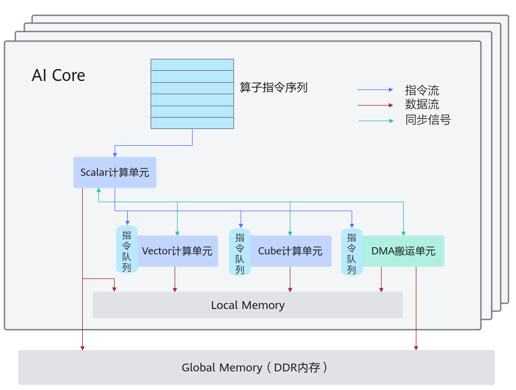
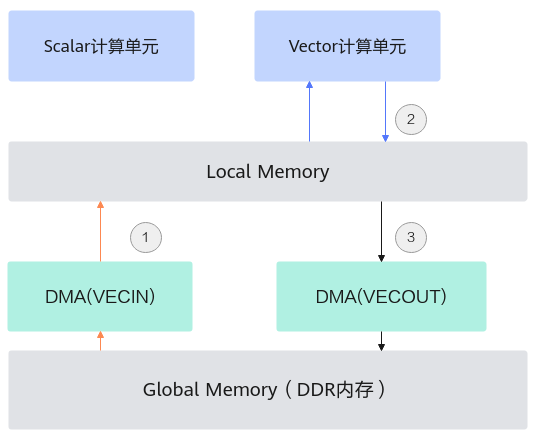
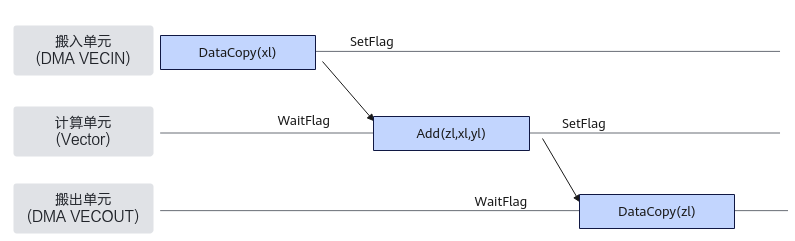
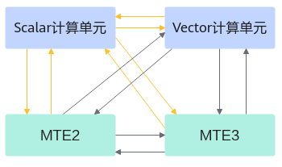

> **Official CANN 9.0.X source reading copy.** [English/Chinese counterpart](../en/sync_control_overview.md); [official page](https://www.hiascend.com/document/detail/zh/CANNCommunityEdition/900/API/ascendcopapi/atlasascendc_api_07_0179.html); [unaltered source body](../raw/0588474b47f9b49e.html). HTML formatting and image paths are converted for offline reading; no local technical corrections.

 

# 同步控制简介

开发者可以使用同步控制接口来自行完成同步控制。需要注意的是，通常情况下，开发者基于[编程模型](https://www.hiascend.com/document/detail/zh/CANNCommunityEdition/900/programug/Ascendcopdevg/atlas_ascendc_10_0012.html)中介绍的编程模型和范式进行编程时不需要关注同步，编程模型帮助开发者完成了同步控制；使用编程模型和范式是我们推荐的编程方式，自行同步控制可能会带来一定的编程复杂度，不建议开发者使用。[TQueSync](https://www.hiascend.com/doc_center/source/zh/CANNCommunityEdition/900/API/ascendcopapi/atlasascendc_api_07_0178.html)类接口和[SetFlag/WaitFlag(ISASI)](https://www.hiascend.com/doc_center/source/zh/CANNCommunityEdition/900/API/ascendcopapi/atlasascendc_api_07_0270.html)中提供的同步控制接口的区别在于，[SetFlag/WaitFlag(ISASI)](https://www.hiascend.com/doc_center/source/zh/CANNCommunityEdition/900/API/ascendcopapi/atlasascendc_api_07_0270.html)中的接口标注为ISASI类别，不能保证跨硬件版本兼容；TQueSync类接口可以保证跨硬件版本兼容。

#### 同步控制简介

介绍同步控制之前需要先回顾一下[图1](https://www.hiascend.com/doc_center/source/zh/CANNCommunityEdition/900/API/ascendcopapi/atlasascendc_api_07_0179.html#ZH-CN_TOPIC_0000002531541438__fig758422819442)。

AI Core内部的异步并行计算过程：Scalar计算单元读取指令序列，并把向量计算、矩阵计算、数据搬运指令发射给对应单元的指令队列，向量计算单元、矩阵计算单元、数据搬运单元异步的并行执行接收到的指令。该过程可以参考[图1](https://www.hiascend.com/doc_center/source/zh/CANNCommunityEdition/900/API/ascendcopapi/atlasascendc_api_07_0179.html#ZH-CN_TOPIC_0000002531541438__fig758422819442)中蓝色箭头所示的指令流。

不同的指令间有可能存在依赖关系，为了保证不同指令队列间的指令按照正确的逻辑关系执行，Scalar计算单元也会给对应单元下发同步指令。各单元之间的同步过程可以参考[图1](https://www.hiascend.com/doc_center/source/zh/CANNCommunityEdition/900/API/ascendcopapi/atlasascendc_api_07_0179.html#ZH-CN_TOPIC_0000002531541438__fig758422819442)中的绿色箭头所示的同步信号流。

AI Core内部数据处理的基本过程：DMA搬入单元把数据搬运到Local Memory，Vector/Cube计算单元完成数据计算，并把计算结果写回Local Memory，DMA搬出单元把处理好的数据搬运回Global Memory。该过程可以参考[图1](https://www.hiascend.com/doc_center/source/zh/CANNCommunityEdition/900/API/ascendcopapi/atlasascendc_api_07_0179.html#ZH-CN_TOPIC_0000002531541438__fig758422819442)中的红色箭头所示的数据流。

 **图1 **AI Core内部并行计算架构抽象 

从上图可以了解到AI Core内部的执行单元是异步并行的，在读写Local Memory内存时，可能存在依赖，需要进行同步控制。

下图示例描述了一个常见的Vector计算数据流：

- 先通过DMA执行单元将数据从Global Memory搬入到Local Memory；

- 进行计算；

- 然后再通过DMA执行单元将计算结果从Local Memory搬出到Global Memory。

四个执行单元Scalar、Vector、DMA(VECIN)、DMA(VECOUT)并行执行，若访问同一片Local Memory，需要同步机制来控制他们的访问时序：保证先搬入Local Memory后再计算，计算完成后再搬出。

  

#### 硬件流水类型

AI Core内部并行的指令流水类型和解释如下所示：

不同的硬件架构，每一种硬件流水类型包含的具体流水会有所差异，详细介绍请参考[硬件实现](https://www.hiascend.com/document/detail/zh/CANNCommunityEdition/900/programug/Ascendcopdevg/atlas_ascendc_10_0007.html)章节。

  

<table>

       <b>表1 </b>指令流水类型和相关说明

      <thead>
       <tr>
        <th>
         
流水类型
</th>
        <th>
         
含义
</th>
       </tr>
      </thead>
      <tbody>
       <tr>
        <td>
         
PIPE_S
</td>
        <td>
         
标量流水线，使用Tensor GetValue函数时为此流水
</td>
       </tr>
       <tr>
        <td>
         
PIPE_V
</td>
        <td>
         
矢量计算流水及部分硬件架构下的L0C Buffer-&gt;UB数据搬运流水
</td>
       </tr>
       <tr>
        <td>
         
PIPE_M
</td>
        <td>
         
矩阵计算流水
</td>
       </tr>
       <tr>
        <td>
         
PIPE_MTE1
</td>
        <td>
         
L1 Buffer -&gt;L0A Buffer、L1 Buffer-&gt;L0B Buffer数据搬运流水
</td>
       </tr>
       <tr>
        <td>
         
PIPE_MTE2
</td>
        <td>
         
GM-&gt;L1 Buffer、GM-&gt;UB等数据搬运流水
</td>
       </tr>
       <tr>
        <td>
         
PIPE_MTE3
</td>
        <td>
         
UB-&gt;GM等数据搬运流水
</td>
       </tr>
       <tr>
        <td>
         
PIPE_FIX
</td>
        <td>
         
L0C Buffer-&gt;GM、L0C Buffer -&gt;L1等数据搬运流水
</td>
       </tr>
      </tbody>
     </table>

#### 同步控制分类

对上述并行流水的同步控制分为两种：

- 多流水同步：通过[TQueSync](https://www.hiascend.com/doc_center/source/zh/CANNCommunityEdition/900/API/ascendcopapi/atlasascendc_api_07_0178.html)的SetFlag/WaitFlag或者[SetFlag/WaitFlag(ISASI)](https://www.hiascend.com/doc_center/source/zh/CANNCommunityEdition/900/API/ascendcopapi/atlasascendc_api_07_0270.html)接口进行不同流水线间的同步控制。 

- SetFlag：当前序指令的所有读写操作都完成之后，当前指令开始执行，并将硬件中的对应标志位设置为1。

- WaitFlag：当执行到该指令时，如果发现对应标志位为0，该队列的后续指令将一直被阻塞；如果发现对应标志位为1，则将对应标志位设置为0，同时后续指令开始执行。

- 单流水同步：通过[PipeBarrier(ISASI)](https://www.hiascend.com/doc_center/source/zh/CANNCommunityEdition/900/API/ascendcopapi/atlasascendc_api_07_0271.html)完成同一流水线内的同步控制，用于在同一流水线内部约束执行顺序。其作用是，保证前序指令中所有数据的读写工作全部完成，后序指令才能执行。

  

#### 什么时候需要开发者手动插入同步

- Vector计算单元 

- 单流水同步：PIPE_V由编译器自动完成同步插入，PIPE_MTE2/PIPE_MTE3在搬运地址有重叠的情况下需要开发者插入同步（具体示例请参考[注意事项](https://www.hiascend.com/doc_center/source/zh/CANNCommunityEdition/900/API/ascendcopapi/atlasascendc_api_07_0103.html#ZH-CN_TOPIC_0000002562301699__li71531626153617)）。

- 多流水同步：PIPE_V、PIPE_MTE2、PIPE_MTE3、PIPE_S之间的多流水同步，都是双向的，如下图所示，黄色线条表示的同步由编译器自动完成同步插入，剩余的同步由Ascend C框架完成。例外情况：使用涉及标量计算的原子操作接口（如[AtomicAdd](https://www.hiascend.com/doc_center/source/zh/CANNCommunityEdition/900/API/ascendcopapi/atlasascendc_api_07_00259.html)）时，如果标量计算单元和搬运单元（MTE2/MTE3）在读写GM时存在数据依赖，开发者需要根据实际情况插入同步。详细内容参见具体的API说明。 

- Cube计算单元 

Cube侧所有流水同步都由Ascend C框架完成，不需要算子开发者插入同步。

上文描述的编译器自动完成同步插入强依赖于LocalTensor间依赖关系，部分场景下需要开发者手动完成同步，具体的约束说明请参考《[毕昇编译器](https://www.hiascend.com/document/detail/zh/CANNCommunityEdition/900/compiler/BishengCompiler/atlas_bisheng_10_0001.html)》。

 **父主题：** [核内同步](https://www.hiascend.com/doc_center/source/zh/CANNCommunityEdition/900/API/ascendcopapi/atlasascendc_api_07_00013.html)
